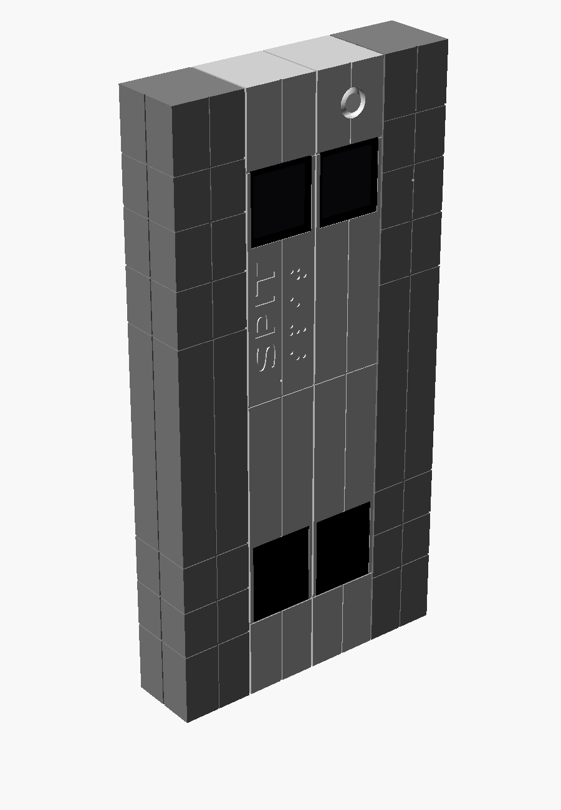
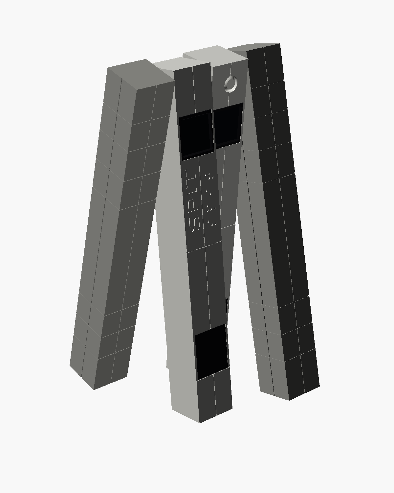
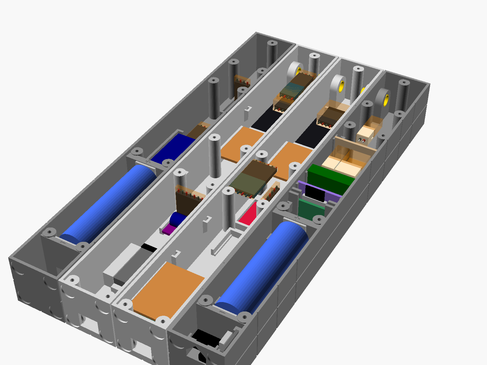
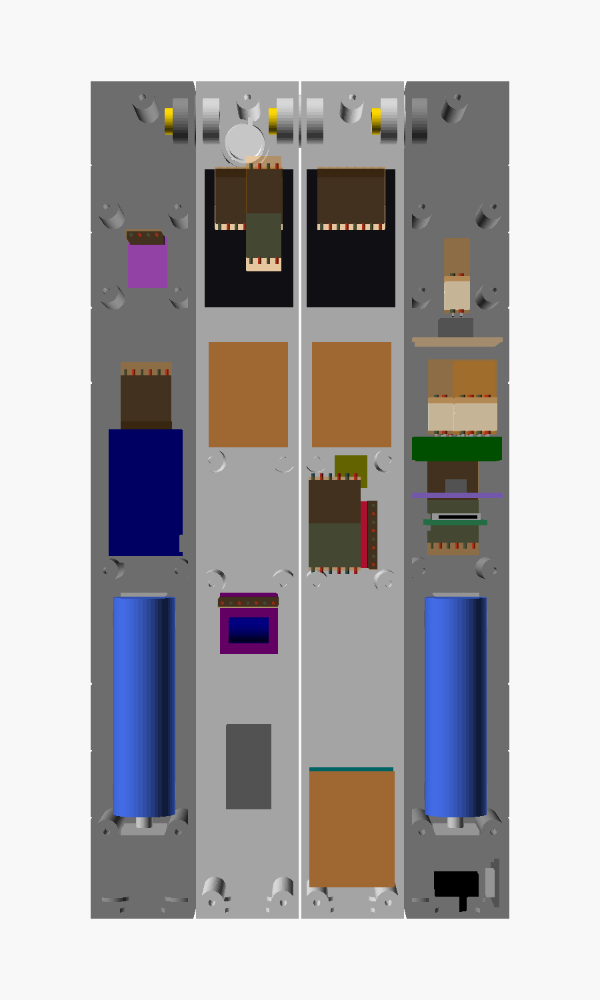

# SPIT

**SPIT** ("SPit Is not TARS") is a desk-size robot after **TARS** from *Interstellar*: **four independent columns** like the film robot, joined by
hollow pivots at the top, one **LOLIN S3 Mini** (ESP32-S3) driving two square 1.3" screens and a speaker, two 18650
cells in the legs. Model: OpenSCAD `mechanical/scad/spit.scad`, fully parametric. Printed on an **Ender 3**.

 

| | |
|---|---|
| Size (W × D × H) | **124 × 31 × 248 mm** (1 : 4 : 8) |
| Brain | 1 × LOLIN S3 Mini (ESP32-S3, 2 MB PSRAM, Wi-Fi, BLE, USB-C) |
| Screens | 2 × 1.3" IPS 240×240 ST7789 with CS (square) |
| Sound | MAX98357A I2S amplifier + 4 Ω 2 W 25.3 × 13.8 × 7.2 speaker behind the lower black panel; INMP441 microphone |
| Sensors | ADXL345 accelerometer, AM312 motion sensor, BME280 weather sensor, DS3231 clock, microSD |
| Power | 2 × 18650 in parallel, one protected TP4056 (0.5 A), power path for mains use, TPS63020 3.3 V buck-boost |
| Joints | brass tubes 8 / 7 mm at the top of each joint, wires inside, a detent click every 15° |

Lying face down, lids off (`part="open"`): pivots and screens at the top of the image, cells at the bottom of the legs.
 

## Where to find what

| Question | Document |
|---|---|
| What must the robot do, within which limits? | [requirements/](requirements/) (functional, technical, performance, configuration, platform) |
| Why is each part there, where does it sit, how is it wired? | [hardware/design_notes.md](hardware/design_notes.md): parts, power and ground, signals and GPIO map, sleep, placement, wiring, colour code, boards, connectors |
| The circuit | [hardware/kicad/spit_schematic.pdf](hardware/kicad/spit_schematic.pdf) (generated by `tools/kicad_sch_gen.py`) |
| How do I build the harness? | [hardware/spit_harness.html](hardware/spit_harness.html) / [.pdf](hardware/spit_harness.pdf): every wire, both ends, in bench-tested steps; board plans `renders/spit_board_*.svg` |
| Wiring sketch | [hardware/spit_wiring.html](hardware/spit_wiring.html) (static copy `renders/spit_wiring.svg`) |
| What is it made of? | [hardware/bom.md](hardware/bom.md); still to buy: [hardware/shopping_list.md](hardware/shopping_list.md) |
| Currents, runtime, sleep | [hardware/power_budget.md](hardware/power_budget.md) |
| Measured dimensions and values | [hardware/measurements.md](hardware/measurements.md) |
| First power-up and bench tests | [tests/bench/bring-up.md](tests/bench/bring-up.md) |
| What is still open? | [open_questions.md](open_questions.md) |
| How do I change and rebuild it? | [CONTRIBUTING.md](CONTRIBUTING.md) |

## Folder layout

| Path | Content |
|---|---|
| `mechanical/` | everything printed: `scad/` (model), `stl/` (one file per part), `3mf/` (Orca projects and raw plates) |
| `hardware/` | electronics: `kicad/`, schematic and wiring pages, wiring guide (`spit_harness.*`), `power_budget.md`, `measurements.md`, `shopping_list.md` |
| `software/` | bench test firmware (`promicro/pir_test`: AM312 on a Pro Micro) |
| `requirements/` | formal requirements (RBD: FUNC / TECH / PERF / UI / CONF / PLAT) |
| `mechanical/scad/spit.scad` | the model (all parameters at the top; `part` selects what is shown or exported) |
| `mechanical/3mf/spit.3mf` | **the Orca project** (5 plates arranged by hand, Ender-3 220 × 220): the file to slice |
| `mechanical/3mf/spit_plate*.3mf` | raw plates from `tools/build4.sh 3mf` (not in git), starting point of `mechanical/3mf/spit.3mf` (stale as soon as an STL changes) |
| `hardware/design_notes.md` | why each part is there and where it sits; power, ground, signal and sleep design rules; placement and wiring |
| `hardware/bom.md` | bill of materials |
| `hardware/kicad/` | KiCad 10 schematic `spit.kicad_sch` (+ PDF), generated by `tools/kicad_sch_gen.py` |
| `hardware/spit_wiring.html` | wiring sketch: back view, lids off, to scale (parts, wires, wires per tube); static copy `renders/spit_wiring.svg` |
| `hardware/shopping_list.md` | what is left to buy |
| `open_questions.md` | open questions and measurements to make |
| `reviews/` | design reviews (electronics, placement) |
| `mechanical/stl/` | one STL per part, in print orientation (not in git: `make check-stl` before a print) |
| `renders/` | PNG / SVG renders (regenerated by the build scripts and tools) |
| `references/` | film still + zoom, wiki movement diagrams, module drawings and photos |
| `tools/build4.sh` | rebuild STLs, plates and renders (`tools/build4.sh [stl\|3mf\|renders\|all\|cr10\|tests]`) |
| `tools/update_orca_project.py` | refreshes the meshes inside `mechanical/3mf/spit.3mf` from `mechanical/stl/`, keeping plates, positions and settings |
| `tools/stl2_3mf.py` | packs STLs into a multi-object 3MF (`--long-x`, `--angle=DEG`); warns if the layout overflows the bed |
| `tools/wiring_svg.js` | exports the sketch of `hardware/spit_wiring.html` to `renders/spit_wiring.svg` (`node tools/wiring_svg.js`) |
| `tools/kicad_sch_gen.py` | generates the KiCad schematic and checks its netlist |
| `tools/boards.py` | hole-by-hole layouts of the hand-wired boards (S3 carrier, P1, P2, power-path board), checked for missing links and shorts → `renders/spit_board_*.svg` |
| `tools/harness.py` | wiring guide `hardware/spit_harness.html`: every wire (W1…) with both ends typed (soldered / Dupont / JST-XH, female / male) in build order, one diagram, wire table and bench test per step; reads the board wires and connectors from `boards.py` |
| `Makefile`, `scripts/check.sh` | validation harness: `make check` rebuilds everything and fails on any problem (see *Rebuild*) |
| `mechanical/3mf/spit_cr10.3mf` | the saved CR-10 Orca project (one-piece parts, one plate), meshes refreshed by the pre-push hook (`meshes` stage) |
| `backups/` | local, git-ignored: copies made by the tools before rewriting a file (history lives in git) |

## Proportions and sizing

The wiki (<https://interstellarfilm.fandom.com/wiki/Robot>) gives **depth : width : height = 1 : 4 : 8**, the top
priority of the design: everything derives from `D` (depth).

- `D = 31` → **124 × 31 × 248 mm**. Columns are `col_w = D − 3·gap/4 = 30.4` wide (4 columns + 3 gaps of 0.8 =
  exactly 4D), walls 1.6 → **27.2 mm inside**.
- What sets D is the screen board (27 mm): it sits in **pockets cut into the side walls** over its height only.
- Other screens in the `SCREENS` catalogue (the model adapts and echoes a note / `WARNING`):

  | `screen` | Screen | Visible area | Min D | SPIT size |
  |---|---|---|---|---|
  | `lcd130cs` (default) | generic 1.3" IPS 240×240 ST7789 with CS, board 27 × 42 | **23.4 × 23.4 square** | 31 | 124 × 31 × 248 |
  | `lcd130` | generic 1.3" IPS 240×240 ST7789 without CS (ZJY-IPS130), board 28 × 39 | 23.4 × 23.4 square | 31 | 124 × 31 × 248 |
  | `oled096` | 0.96" SSD1306 OLED 128×64 I2C, board 27 × 27 | 21.7 × 10.9 (2:1) | 30 | 120 × 30 × 240 |
  | `lcd085` | Waveshare 0.85" IPS 128×128 GC9107, board 22.5 × 19 | 15.2 × 15.2 square | 28.5 | 114 × 28.5 × 228 |
  | `lcd169` | Waveshare 1.69" IPS 240×280 | 28 × 32.6 | 36.5 | 146 × 36.5 × 292 |

  Below D ≈ 30 the controller board (25.4 wide) slides in grooves cut in the side walls automatically.
- Frame of reference: x = width (left → right seen from the front), y = depth (0 = front face), z = height (0 = floor).
  Columns 0–3 from SPIT's left: col0 left leg, col1 left middle, col2 right middle, col3 right leg.

### Decor (from the film still `references/film_still_tars.jpeg`)

- **Screens** at the top of the middle columns, **lower black panels** near the bottom (z 0.132–0.267·H): both are
  cut **through** the 1.6 mm front wall and filled with **flush black plugs** 1.6 mm thick (0.15 clearance). The screen
  plug carries the bevelled window and is backed by the screen glass; the lower plug rests on a 1 mm ledge inside and on
  the splint at the top. A drop of CA glue on the edges.
- **"SPIT"** engraved vertically (reads bottom to top) in the left strip of the left middle column, with **"SPIT" in
  braille** in the right strip, as TARS carries its name in the film.
- Fine lines (0.8 × 0.4 mm): a vertical groove in the middle of each column, horizontal lines at the top of the screens,
  at mid-height and at the bottom of the lower panels; plate joints on the legs.
- Speaker grille: horizontal slots in the right middle column's lower plug (black on black, barely visible).

## Printing

### Parts (all front face / outer face on the bed, no supports)

| Part | STL | Qty | Length | Notes |
|---|---|---|---|---|
| Left leg, bottom / top | `mechanical/stl/spit_col0_bottom.stl`, `mechanical/stl/spit_col0_top.stl` | 1 + 1 | 158.7 / 89.3 | 18650 between spring contacts, micro-USB charge port and switch in the foot, microSD, TPS63020 and TP4056 lying flat (bottom half); power-path board (top half) |
| Right leg, bottom / top | `mechanical/stl/spit_col3_bottom.stl`, `mechanical/stl/spit_col3_top.stl` | 1 + 1 | 158.7 / 89.3 | 18650 between spring contacts, DS3231 clock (bottom half), BME280 + vent (top half) |
| Left middle, bottom / top | `mechanical/stl/spit_col1_bottom.stl`, `mechanical/stl/spit_col1_top.stl` | 1 + 1 | 66.2 / 181.8 | "SPIT" + braille, screen 1, LOLIN S3 Mini on its carrier (USB-C through the floor), spare slot; ADXL345, INMP441, P1 |
| Right middle, bottom / top | `mechanical/stl/spit_col2_bottom.stl`, `mechanical/stl/spit_col2_top.stl` | 1 + 1 | 66.2 / 181.8 | screen 2, speaker, MAX98357A, AM312 ring, P2 |
| Leg lid, bottom / top | `mechanical/stl/spit_lid_leg_bottom.stl` (right leg), `mechanical/stl/spit_lid_leg_sd_bottom.stl` (left leg: microSD slot), `mechanical/stl/spit_lid_leg_top.stl` | 1 + 1 + 2 | 196.5 / 47.7 | split at 198.4, above the column seam: the bottom lid bridges it; vents at z 141–149 and 217–230 |
| Middle lid, bottom / top | `mechanical/stl/spit_lid_mid_bottom.stl`, `mechanical/stl/spit_lid_mid_top.stl` (right middle), `mechanical/stl/spit_lid_mid_left_bottom.stl`, `mechanical/stl/spit_lid_mid_left_top.stl` (left middle, no speaker tabs) | 1 + 1 each | 112.2 / 132.0 | split at 0.46·H; bottom: controller lug, 4 tabs behind the controller, speaker tabs (right only), 45° gussets; top: two continuous screen ribs |
| Splints | `mechanical/stl/spit_splint.stl` | 1 set of 4 | 20 tall | glued inside across each seam |
| Black plugs | `mechanical/stl/spit_inserts.stl` (left middle), `mechanical/stl/spit_inserts_speaker.stl` (right middle, grille) | 1 + 1 set | | screen panel (with window) + lower panel, **black filament** |
| Tube collars | `mechanical/stl/spit_collar.stl` | 1 set of 3 | | glued on the pivot tubes, PETG |

Overhangs: none needs support (45° slopes, teardrop pads, short bridges ≤ 11.6 mm, 8 mm tube bores): supports off.

### Split for printing (Ender 3)

Orca's Ender-3 bed is **220 × 220**, so **every column and lid is printed in two halves** (longest piece 182 mm).
- Seams sit on lines that already exist: **middle columns** on the top edge of the lower black panel (66.2 mm, covered
  by the plug edge), **legs** on the 0.64·H plate line (158.7 mm). Nothing crosses a seam (lid screws, controller,
  battery bay and pivots are clear of seam ± 10 mm).
- The U **splint** (front + both sides, 1.6 mm = 4 lines, 20 mm tall, printed standing with a 3–4 mm brim) is glued
  inside across the seam (**epoxy**). Lay both halves face down on glass while it sets so the fronts stay flush.
- Lids are split **away from the column seams** (legs at 198.4, middles at 114.1): the bottom lid half is screwed into
  both column halves and bridges the seam at the back, so each seam is held on 4 sides. 0.2 mm gap between lid halves.

### Slicing

**Slice `mechanical/3mf/spit.3mf`** (Ender-3 0.4, 220 × 220, elephant foot compensation 0.15). After a model change (Orca has no
usable *Reload from disk* here):
1. `tools/build4.sh stl` (new STLs), close the project in Orca;
2. `python3 -I tools/update_orca_project.py mechanical/3mf/spit.3mf`: replaces each object's mesh by the STL of the same name, keeps
   every plate / position / rotation / setting, adjusts only the height so parts sit on the bed, prints what changed,
   backs up first (`--check` = dry run);
3. reopen `mechanical/3mf/spit.3mf` in Orca.

The pre-push hook runs step 2 on both projects when the STLs changed (`meshes` stage) and refuses the push until the
rewritten projects are committed: close them in Orca before pushing, or saving from Orca puts the old meshes back.

Raw plates (`tools/build4.sh 3mf`, ~20 mm margins), only to rebuild the Orca project from scratch:

| Plate | Content | Footprint |
|---|---|---|
| `mechanical/3mf/spit_plate1_columns.3mf` | 2 middle tops, 2 leg tops (end to end), 2 middle bottoms (end to end) | 183 × 138 |
| `mechanical/3mf/spit_plate2_legs.3mf` | 2 leg bottoms, 4 leg lid halves, 3 tube collars | 197 × 173 |
| `mechanical/3mf/spit_plate3_lids.3mf` | 4 middle lid halves, 4 splints | 132 × 150 |

Black plugs and the test pieces are separate small prints.

**CR-10 option** (300 × 300): `tools/build4.sh cr10` exports the columns and lids **in one piece**
(`mechanical/stl/spit_cr10_*.stl`) on one plate `mechanical/3mf/spit_cr10_plate.3mf` (261 × 248). The Orca project to slice is
`mechanical/3mf/spit_cr10.3mf`, created once from that layout by `make check-orca` and then only refreshed (Orca's own auto-arrange
pushes the 248 mm columns off the bed: keep the strip layout or arrange by hand). No seams, no splints; the top 10 mm of the
lower black plug then has no ledge behind it: a drop of glue.

### Material

SPIT sits on a desk, indoors → **matte grey PLA** for everything visible (closest to the film's brushed aluminium,
crisp fine lines / braille / text, hides layer lines), **matte black PLA** for the panel plugs.
- One grey for all columns (the renders use two shades only for readability).
- **PETG** for the wear parts: the 3 tube collars (and the bearing rings' detent bumps if they wear).
- **Epoxy** rather than CA for the splints (CA gets brittle). Lid screws (straight into PLA) snug, not forced.
- Keep it out of direct sun / away from heaters (PLA softens at ~55–60 °C).
- Smooth PEI or glass → uniform satin front; textured PEI blurs the fine lines.
- Matte PLA has slightly weaker layer adhesion: 1.6 mm walls = 4 lines at 0.4; a few °C more on the nozzle.
- If it ever has to live in a car / sun: all **PETG** + a coat of matte clear spray.

## Pivots

- **One pivot per joint, at the top** (238.4 mm, as high as the bosses allow so it clears the screen board): the
  two-legged walk. The wires run through the tubes, so there is no centre pivot (no crutch walk / wheel).
- Tube: **brass 8 / 7 mm** (`tube_od = 7.93` measured), ~20 mm long per joint. Glued into the left-hand column of the
  joint (teardrop hole 8.00), turning in the right-hand one (teardrop hole 8.05, PLAT-MECH-PIVOT-001) on a Ø16 bearing ring with 2 detent bumps; 24 dimples on the fixed side
  → a click every 15°. A printed collar (Ø13 × 2, `collar`) glued on the tube inside the turning column holds the joint
  together; the tube sticks out 0.5 past it (`tube_over`). Bosses Ø14 × 5 inside the walls; nothing else at that height.
- Swinging back and forth is fine; endless rotation would need a Ø12.5 slip ring.

## Assembly order

1. Print, glue the halves and splints.
2. Parts on the front wall: screens, ADXL345, INMP441, amp, BME280, DS3231 with B+ pre-formed, speaker, charge port,
   switch, fuses + contact plates.
3. Tubes glued in their fixed column, harness threaded bare, collars.
4. Flat boards bottom-up from the back (microSD, power block); P1 / P2; the S3 + carrier last.
5. Plug X1–X16, continuity check P1 / P2 → every housing, tie the bundles to the printed anchors.
6. Close the lids (nothing over a post), test, cells last.

## Feet and stability

- **Feet**: 4 recesses Ø8.4 × 0.8 under every column for stick-on rubber feet.
- **Stability** (echoed by the model): ~400 g, centre of gravity ~112 mm high → standing straight, SPIT tips over past
  only **~8°** front/back (31 mm deep base). Display it in the **walking pose** (legs swung 10–15°) or keep the
  detents firm; rubber feet help against sliding, not tipping.

## Bring-up

Bring-up order, bench test sheets and their results: [tests/bench/bring-up.md](tests/bench/bring-up.md).

## Requirements

The robot is specified in `requirements/` (requirement-based development, `.rbd/config.yml`): FUNC (what the
robot does), TECH (constraints), PERF (measurable limits), CONF (settings), PLAT (how it is built on this hardware,
each deriving from a FUNC / TECH requirement), UI. IDs are `<CAT>-<DOMAIN>-<FEATURE>-NNN`. Written so far: POWER
(validated, or `draft` while a bench measurement is pending), MECH (charge port, pivot bores, joints), HARNESS (board
layouts) and BUILD (checks, build artifacts, project name). Values set by a requirement are not repeated elsewhere:
the other documents link to it.

## Branches

| Branch | Content |
|---|---|
| `main` | the design (model, hardware docs, requirements) |
| `bench-tests` | bench test firmware for the D1 mini and the S3 Mini (`d1mini/`, `s3mini/`, `bench_assets/`), not merged |

## Rebuild

Step by step, offline included, with the validation stages and the git hooks: [CONTRIBUTING.md](CONTRIBUTING.md).

```
cd spit                                   # your clone of the repository
tools/build4.sh                           # all half STLs, the 3 raw plates, renders (~10 min)
tools/build4.sh stl                       # only the STLs
tools/build4.sh renders                   # only the renders
tools/build4.sh cr10                      # CR-10 one-piece parts and their plate
tools/build4.sh tests                     # trial prints (tube_test3)
openscad mechanical/scad/spit.scad       # interactive; `part` selects what is shown
python3 -I tools/boards.py                # board layouts, checked (renders/spit_board_*.svg)
python3 -I tools/update_orca_project.py mechanical/3mf/spit.3mf   # swap the Orca project's meshes
```

`make check` rebuilds what changed and fails on any problem; `make hook` installs the git hooks (fast checks on
commit, slow ones on push).

On Windows, run the Python tools as `python3 -X utf8 -I tools/<script>.py` (the default cp1252 console encoding
chokes on Ω / µ).

Overrides: `-D 'screen="oled096"' -D D=30`, `-D 'leg_angle=[20,-20]'`, `-D pir=false`, `-D bme=false`. The model echoes
notes and `WARNING`s (clashes, connector boxes, stability): check them after every change. Pose renders are built from
the column meshes in `tools/build4.sh` (constants at the top of its scene must match `mechanical/scad/spit.scad`).
