# SPIT — design notes

Why each part is there and where it sits, plus the design rules behind the circuit. The circuit itself is the KiCad
schematic ([kicad/spit.kicad_sch](kicad/spit.kicad_sch), PDF [kicad/spit_schematic.pdf](kicad/spit_schematic.pdf)),
the boards are the plans generated by `tools/boards.py` (`../renders/spit_board_{s3,p1,p2,power}.svg`, checked against the
schematic), the GPIO assignment is the *Signals* table below, the wiring is [spit_wiring.html](spit_wiring.html)
and the harness guide [spit_harness.html](spit_harness.html). Requirements: `requirements/`.

## Parts

| Ref | Part | Why / where |
|---|---|---|
| U1 | TP4056 + DW01 + FS8205A | 0.5 A charge: its R_PROG (1.2 k, "122") is replaced by 2.4 k ("242"); at 1 A it would dissipate 1–1.8 W in the closed leg. Cell protection. |
| BT1, BT2 | 18650, in parallel | same model, voltages equal within ±0.05 V before joining them; each cell comes through its XH connector (X12 left, X16 right), joined on the TP4056 B+ / B− pads |
| F1, F2 | PPTC 30 V, 1.6 A hold (~3.2 A trip), XF160 | on the + of each cell, right after the + plate; standing on the inner front wall in front of each cell (15 mm wide: too wide for the top shelf) |
| J1 | micro-USB breakout (`usbb` in the model) | the charge port, at the heel of the left leg; its VBUS / GND go to the TP4056 IN pads |
| D3 | TVS SMAJ5.0A / SMBJ5.0A, unidirectional | on the TP4056 IN+ / IN− pads, cathode on IN+: electrostatic discharges; does not protect against a lasting overvoltage |
| C9 | 22 µF 16 V electrolytic (10–47 µF), Ø ≤ 5.15 lying | with D3 on the TP4056 IN pads: damps the hot-plug overshoot at the end of the ~16 cm of wire from J1 |
| Q1 | AO3401A, logic-level P-MOSFET | power path: cells → VSYS, off on mains (gate on VUSB) |
| D1 | 1N5822, 3 A Schottky, through-hole | VUSB → VPATH on mains; band on the VPATH side, before the switch |
| R1 | 4.7 k | Q1 gate → GND: fast switch-over when unplugged (~50 ms); a warm D1 leaking 50 µA leaves the gate < 0.25 V |
| SW1 | slide switch, ≥ 1 A | after the merge point; rating to check (often only 0.3–0.5 A) |
| U9 | TPS63020 module, 3.3 V | buck-boost in the left leg, 3.3 V to the S3 3V3 pin; EN to VIN, PS/SYNC to GND (solder bridge, never high). Its own VSYS / GND pair from the star; the logic GND to P1 leaves from its GND pad, along its 3V3 wire |
| C1 | 220 µF 10 V polymer tantalum 7343 (Panasonic 10TPE220ML, ESR 25 mΩ), band = + | mandatory: 3V3 → GND as close as possible to the S3 3V pin, flat on the carrier under the S3, ~35 cm of wire from the TPS63020 |
| R15, R16 | 68 k + 100 k | on the power-path board: VUSB → USB_DET (GPIO21), ~3 V with the charger plugged in, 30 µA on USB only; switch off with the charger in, ~60 µA flow from this ~40 k divider into the unpowered 3V3 through GPIO21's protection diode (harmless, well below the pin's injection limit) |
| R2, R3 | 1 M + 1 M | R2 in line in the harness at the TP4056 B+ pad (the sense wire carries B+ only behind 1 M), R3 on the power-path board: B+ / 2, the cell voltage even on mains (VSYS is then the USB rail, ~4.6 V); the VBAT/2 wire goes to GPIO1 (≈ 2 µA standing, C6 holds the reading) |
| Q4, R23, R24 | BC547B NPN + 1 M + 330 k (1/4 W) | VSYS sense (GPIO37, low = rail up, threshold 2.3–2.7 V with the Vbe spread, inside the 2.3–3.0 V window of FUNC-POWER-VSENSE-001; VSYS only crosses 2.3–2.5 V at power-up or cut-off, where a silent amplifier is harmless): R23 soldered in line in the harness at the power-path board end (the wire through the left tube only carries VSYS behind 1 M), then X14 → R24 base → GND and Q4 standing on the carrier, collector bridged to IO37 (internal pull-up only while reading), ~3–4 µA |
| C6 | 0.1 µF ceramic ("104"), never tantalum nor film | GPIO1 → GND at the S3: a tantalum's leakage would skew the reading by up to 0.5 V; film is too wide |
| C8 | 0.1 µF ceramic ("104") | GPIO21 → GND at the S3: USB_DET comes out of a ~40 k divider and runs along the amplifier pair in the left tube |
| C2, C3 | 10 µF 16 V tantalum (+ to 3V3) or X5R / X7R ceramic, + 0.1 µF ceramic | on P1, between the 3V3 and GND strips |
| R4 | 10 k | on P1, BL_EN → GND: backlights off at boot |
| R10 | 1 k | on P2, in series GPIO4 (AMP_SD) → amplifier SD |
| R18 | 10 k | on P2, amplifier SD → GND: the amplifier stays off at boot and in sleep despite its board's pull-up (SD < 0.16 V) |
| C7 | 470 µF 10 V low-ESR electrolytic, Panasonic EEUFC1A471, Ø8 × 11.5, − to GND | on the amplifier VIN / GND pins (module side of X5), lying behind the board |
| R11, R13, R14, R20 | 33 Ω | in series at the S3: microSD CLK, amplifier BCLK and LRC, screens MOSI |
| R12, R19 | 47 Ω (up to 100 Ω) | on the S3 carrier: split SCK, R12 → screen 1, R19 → screen 2 through its own wire |
| R5–R9 | 10 k | microSD pull-ups (CMD, D0–D3) to SD_3V3, if the reader has none |
| Q5, R22 | AO3401A + 100 k | on the power-path board: cuts the microSD 3V3 in sleep (GPIO36 SD_EN low = on; R22 gate → 3V3 keeps it off while the pin floats) |
| C4, C5 | 10 µF 16 V tantalum (+ to SD_3V3) + 0.1 µF ceramic | at the microSD reader (hot insertion) |
| R17 | 1 k | on P2, in series between the AM312 output and the PIR wire (GPIO3): limits the current if the pin is misconfigured |
| R21, C12 | 100 Ω + 10 µF 16 V tantalum (+ on PIR_VDD) | on P2 (fc 160 Hz, ~40 dB at 20 kHz): filters the AM312 supply against the backlight PWM ripple on the shared 3V3 |
| C10, C11 | 10 µF 16 V tantalum (+ to 3V3) + 0.1 µF ceramic | on P2, between the 3V3 and GND strips |
| U10 | AM312 PIR | top of the right middle column, dome flush in a Ø11.5 front hole (cap glued from the inside), 1.25 mm right of the axis to clear the middle tube; 2.7–12 V, ~15 µA, push-pull output held ~2 s, active high |
| U11 | BME280 (GY-BME280, 3.3 V) | right leg, the coolest spot, sensor against the wall facing a Ø1.5 vent; I2C 0x76 / 0x77; SDA / SCL / 3V3 / GND from P2 through the right tube |
| LS1 | speaker, 4–8 Ω | on OUT+ / OUT− (no ground); size not settled (branch `mech-audio`) |
| P1, P2 | stripboards 24 × 32 | distribution: P1 left middle under screen 1, P2 right middle under screen 2 |
| U2 socket | 2 female 2 × 8 headers on the 25.6 × 34.4 carrier (P3) | the S3 plugs in; all its wires are soldered on the back of the carrier |
| X1–X16 | keyed Dupont (X1–X9, X15), JST-XH (X10, X12, X13, X14, X16) | one connector between each module and the harness, nothing to re-solder to test or swap a module; list and keying in the wiring plan |
| (Q2, Q3) | AO3401A + AO3400A or 2N7002 + 10 k | probably not needed: BLK most likely drives an on-board transistor (a few mA). Only if the measurement shows BLK feeds the LEDs |

## Power and ground

- B− is not GND: the DW01 and its MOSFETs (FS8205A) sit between them. Everything else refers to OUT− (GND).
- Star ground on the power-path board (left leg): the TPS63020 and the amplifier each get their own VSYS / GND pair from
  it; the logic GND to P1 leaves from the TPS63020 GND pad and runs along its 3V3 wire (a single loop); the microSD
  gets its own GND from P1. Twisted pairs: B+ / B−, amplifier VSYS / GND, microSD CLK / GND.
- On mains, VUSB turns Q1 off (gate at 5 V) and feeds VSYS through D1 (≈ 4.7 V); the cells charge on their own. On
  battery, R1 pulls the gate to 0 V and Q1 conducts.
- Battery cut-off at 3.3 V read on B+ (GPIO1, under load): the TPS63020 holds 3.3 V down to ~2.5 V input, the cut-off
  only spares the cells.
- The S3 V pin (VBUS) only gets its own USB-C (its contact is removed from the carrier header): a PC's 5 V only feeds
  the S3 internal regulator (ME6211, 500 mA), never VSYS nor the cells. Flash with the switch on or off. On USB, the
  ME6211 and the TPS63020 feed the 3V3 together: the TPS63020 in power-save mode does not fight it. Never drive its
  PS/SYNC high: in forced PWM it can sink current and send the S3 regulator's current back to the cells. On battery, a
  little 3.3 V leaks back through the ME6211 to VBUS (to measure, cable plugged into a PC that is off).
- To check: the TPS63020 must not start from its output (VSYS < 2.5 V), the max input voltage of the unpowered MAX98357A.

Power path (load sharing): on mains the charger feeds the robot while the cells charge and terminate on their own
(otherwise the TP4056 sees the robot's current as charge current and never ends the charge):

```
TP4056 IN+  (USB 5 V) ──► Schottky D1 1N5822 ───────────┐
                                                        ├──► slide switch ──► VSYS
TP4056 OUT+ (cells)   ──► AO3401A P-MOSFET Q1 (D → S) ──┘
                           gate → IN+, R1 4.7 kΩ gate → GND
```

- The switch sits after the merge: off = robot off, charging still works. Use a 5 V ≥ 2 A charger (0.5 A charge + up to
  ~1 A for the robot on mains: a PC port is not enough).
- The battery is read on the cells, not on VSYS: on mains VSYS is the USB rail (~4.7 V) and says nothing about the
  battery. B− needs no wire (it differs from GND only by the DW01 switches, < 50 mV).

### Battery thresholds

Defaults of the configuration constants of [CONF-POWER-THRESH-001](../requirements/configuration.md#conf-power-thresh-001)
(used by FUNC-POWER-MONITOR-002, FUNC-POWER-CUTOFF-001 / 002, FUNC-POWER-DETECT-002), from the cell datasheet and the
TPS63020 input range; the bench measurements may move them (record the measured value in
[measurements.md](measurements.md)).

| Constant | Default | Why |
|---|---|---|
| Level bounds fed / peckish / hungry | 3.90 / 3.70 / 3.50 V | hunger levels; to check against the cells' discharge on the bench |
| Cut-off (empty) | 3.30 V | ~5–10 % left (*Sleep and wake-up*); the TPS63020 holds 3.3 V down to ~2.5 V in, so the cut-off only spares the cells |
| No-battery limit | 2.50 V | GPIO1 < 1.25 V: no cells, the S3 runs from a PC's USB: the cut-off is ignored |
| Averaging window | 60 s | longer than any Wi-Fi / amplifier peak: the only hysteresis of the levels |
| Charge full | peak ≥ 4.10 V, then 20 mV below the peak | end of charge deduced from B+ while USB_DET stays high (*Signals*; audit D5) |
| Empty-lockout release | 3.50 V | = the hungry bound: the robot wakes up hungry, not starving |
| Lockout re-check interval | 10 min | timer wake on the supply only; no wake on battery alone |

## Signals

| Function | Signals | Notes |
|---|---|---|
| SPI (shared by both screens) | SCK, MOSI, DC | one SPI host with DMA; SCK split on the carrier (R12 / R19 47 Ω, one wire per screen), MOSI through R20 33 Ω |
| Chip select | CS1, CS2 | |
| Screen reset | RST (shared) | `RST = -1` in the library, one manual reset for both |
| Backlight | BL_EN | GPIO7 → BLK of both screens (PWM ~20 kHz), R4 10 k to GND; low in deep sleep |
| Amp shutdown | AMP_SD | GPIO4 → R10 1 k → MAX98357A SD, R18 10 k to GND (both on P2); low in deep sleep |
| I2S0 → MAX98357A | BCLK, LRC, DIN | through the middle tube, R13 / R14 33 Ω on BCLK / LRC at the S3 |
| I2S1 ← INMP441 | SCK, WS, SD | local (GPIO 14, 38, 15) |
| Charger detect | USB_DET | GPIO21 ← VUSB through R15 68 k / R16 100 k (~3 V when plugged in), C8 100 nF at the S3; wakes the S3 on plug-in |
| I2C | SDA, SCL | ADXL345 (0x53) in the left middle, then BME280 (0x76) and DS3231 (0x68) in the right leg through two tubes; 100 kHz |
| Motion | PIR | GPIO3 ← AM312 OUT through R17 1 k on P2 (active high) |
| Battery | VBAT/2 | GPIO1 (ADC1) ← B+ divider |
| microSD | CLK, CMD, D0 + SD_EN | SDMMC 1-bit, 10 MHz, R11 33 Ω on CLK; SD_EN GPIO36 → Q5 (low = card powered) |

The ESP32-S3 routes SPI and I2S to any GPIO. Avoid the strapping pins (GPIO 0, 45, 46; GPIO3 only selects the JTAG
source when an eFuse is burnt, so it is used as the PIR input) and the USB pins (GPIO 19, 20). GPIO37: VSYS sense (Q4 BC547B and R24 330 k on the carrier, R23 1 M in line in the harness at the power-path board; low = rail present; PLAT-POWER-VSENSE-001). Pin by pin:
the carrier plan `../renders/spit_board_s3.svg` and the KiCad schematic (confirm when soldered).

- Through the middle tube go **7 wires** for screen 2 (SCK, MOSI, DC, CS2, RST, 3V3, GND from P1) + BL_EN + 3 for I2S +
  AMP_SD, next to B+/B−, the amp's VSYS/GND pair, PIR, SDA and SCL (19 wires, see *Wires per tube*).
- **BL_EN** drives only the screens' BLK (not the S3's "EN" pad, which is its reset). The screens have their own
  VCC / GND, so BLK most likely drives an on-board transistor (a few mA): a GPIO is enough. An on-board BLK pull-up only
  lights the backlights at boot (and ~0.66 mA in deep sleep: measure, remove it). Only if BLK feeds the LEDs directly
  (40–60 mA) → AO3401A high-side from 3V3 to BLK, gate pulled up by 10 k, pulled down by an AO3400A / 2N7002 on BL_EN.
- Libraries: TFT_eSPI or LovyanGFX (ST7789, 240×240, two CS), `ESP_I2S` for the MAX98357A (MP3 decoding fits in the PSRAM).
- BL_EN (GPIO7) only drives the backlights: PWM possible (LEDC, ~20 kHz). R4 holds it low at boot, `gpio_hold` in
  sleep. Not the S3 EN pad (that is its reset, next to GPIO1).
- AMP_SD (GPIO4): R10 in series and R18 to GND on P2, the amplifier stays off at boot and in sleep whatever is on BLK;
  high (> 1.4 V) = left channel. To check: the SD pull-up on the amplifier board (Adafruit: 1 M).
- Amplifier on I2S0 (BCLK, LRC, DIN), microphone on I2S1 with its own clocks (GPIO 14, 38, 15), wired locally: neither
  imposes a sample rate on the other.
- Screens: SPI at 26.7 MHz to start (35 ms per frame and screen), 40 MHz to try (ST7789 ~62 MHz max); SCK split on the
  carrier (R12 → screen 1, R19 → screen 2, its own wire), up to 100 Ω if the image jitters; screen 2's SCK next to its
  GND in the tube, away from BCLK; GPIO12 with reduced drive strength. Shared RST: `RST = -1` in the library, one reset.
- microSD: on a reader labelled for SPI, CLK = SCK, CMD = DI / MOSI, D0 = DO / MISO, D3 = CS (pull-up). SDMMC 1-bit
  10 MHz, R11 in series on CLK, C4 / C5 at the reader.
- I2C at 100 kHz with the glitch filter: ADXL345 0x53, BME280 0x76, DS3231 0x68 + its EEPROM 0x57. The boards'
  pull-ups add up (~1.6–2.4 k): fine at 100–400 kHz, remove one pair if needed. ADXL345: CS to 3V3 (I2C), SDO to GND.
- DS3231 ZS-042 with a CR2032: remove the cell charging resistor; SQW not wired (the S3 wakes on its own timer, the
  RTC keeps the time).
- Charger detection: USB_DET (GPIO21) high = cable in the charge port (display, no battery cut-off, wake on plug-in).
  End of charge is deduced from B+ (GPIO1) falling ≥ 20 mV below its peak (≥ 4.10 V) while USB_DET stays high.

## Sleep and wake-up

- Wake-up: on the ESP32-S3, EXT1 takes one polarity only. Everything is active high: ADXL345 INT1, PIR (AM312) and
  USB_DET → EXT1 ANY_HIGH on GPIO 2, 3 and 21. Remove from the mask any source already high when going to sleep
  (GPIO21 on mains, GPIO3 while the PIR holds), otherwise the S3 wakes at once. Timed wake-up: the S3 timer. Clear the
  ADXL345 INT_SOURCE and wait for PIR low before sleeping.
- Sleep target ≤ 0.65 mA with the card cut (PERF-POWER-SLEEP-001), estimate ~0.3–0.5 mA (power_budget.md): remove the S3 RGB LED (GPIO47, 0.3–1 mA even off) and every status LED fed by the
  battery (ZS-042, TPS63020 module, GY-291, microSD reader), keep the TP4056 charge LEDs (USB only); disable the DS3231
  32 kHz output (register 0x0F bit 3); send SLPIN to the screens; `gpio_hold` on CS1 / CS2 / RST / BL_EN / AMP_SD; Q5
  cuts the microSD 3V3 (SD_EN high or floating).
- Deep discharge: after the 3.3 V cut-off ~5–10 % of capacity is left; the TPS63020 (25–50 µA), the R2 / R3 divider
  (2 µA), the SD card (0.1–0.5 mA), the RGB LED and above all the ZS-042 LED (1–3 mA) would drain it in 1–3 weeks.
  Store an "empty" flag in RTC memory (no wake-up until recharged).
- Firmware: ignore the cut-off if B+ < 2.5 V; keep BL_EN, AMP_SD and the amplifier I2S off until the supply is
  validated (VSYS sense on GPIO37, PLAT-POWER-VSENSE-001).
- Motion sensor uses: wake on approach, lock the PC (BLE keyboard) when leaving.

## Placement

### Controller: LOLIN S3 Mini

Original **LOLIN S3 Mini** (wemos.cc, 34.3 × 25.4; the model calls it `d1`), ESP32-S3FH4R2: 4 MB flash + **2 MB
PSRAM** (full frame buffers for both screens), SPI with DMA, native I2S, native **USB-C**, BLE. Buttons 0 / RST at the
USB end.
- Vertical in the left middle column, components facing the front, **plugged into a carrier** (`s3_socket`): two
  2 × 8 female headers on a perfboard of the same outline, 6 mm in front of the lid; every wire is soldered on the
  carrier's back, never on the S3 (layout: `../renders/spit_board_s3.svg`, see *Hand-wired boards*). USB-C at the bottom, the board **standing on the bottom lid screw posts**
  (`d1_z0` = 8.1), reachable through an **11.6 × 9 mm** floor opening (most USB-C overmolds are ≤ 11.5 wide). Lay
  SPIT down to flash, then OTA.
- Held by strips on the side walls (0.15 play) from 4.5 mm above the bottom (`d1_btn`, clear of the buttons), 2.5 mm
  ribs in front and tabs on the lid behind, in the two pad-free bands (4.5–7 and 27.9–30.4), 2 mm on the RST side where
  the edge is stepped in (`d1_notch`); the lid lug keeps it down. Values from the LOLIN drawing
  (`references/s3_mini_dimensions.png`): check on arrival.
- Carrier wires: a **6–8 cm service loop**; every wire, including those on the edge columns A / J (x 3.8 / 26.6), first
  runs flat inwards (columns C–H) on the solder side before turning up or down, so nothing lies outside x 5–25 in the
  lid-tab bands 4.5–7 and 27.9–30.4; nothing over the S3's top band (antenna). The BOOT button is reached with the S3 pulled out of its socket.
- **The S3's VBUS pin is only its USB-C** (its contact is pulled out of the carrier's female header, so it never reaches
  the carrier, where it would sit between GND and MIC_SD): the PC's 5 V reaches only the S3's LDO, never VSYS
  or the cells → **flash / debug with the switch on or off**.

### Screens

- 8-pin board **27 × 42**, visible area 23.4 × 23.4 (the film panel at this size is 27.4 × 28.8: a ~2 mm black border,
  close to the film). With a CS pin both screens share one SPI bus, so **one controller drives everything**.
- Fits the 27.2 mm interior (0.1 mm wall pockets); frame z 180.3–225.9 (clipped to the column width), ~6 mm below
  the top pivot. **Glass position and mounting holes not measured yet**: `active_dz = 0` (centred), held by the frame
  → check with the screen test piece (not exported any more: `openscad -D 'part="print_test_screen"' -o test_screen.stl mechanical/scad/spit.scad`), then update the `lcd130cs` entry in `SCREENS`.
- Two **continuous ribs on the middle lid** (`scr_rib`, 2.6 mm from each side wall, the board's whole height) press
  on its side edges from behind, so the screen cannot tip back, and the wires come down between them (x 5–25).
- Its header is replaced by a **right-angle** one on the back, pins down (`scr_hdr_ra`): X1 / X4 lie flat on the
  screen's back (see *Connectors (demountable wiring)*).
- `lcd130` (7 pins, no CS, ZJY-IPS130, `references/lcd_1.3_st7789_zjy-ips130.jpg`) is the alternative: it needs one SPI
  host per screen, sits on 4 M2 standoffs (`active_dz = 1.7`, holes 23.2 × 34.1) and its panel hole stops at 216.3.

### Cells

- Each **leg** carries one **18650** (Ø18.6 × 65; `bat = [18.5, 50]` for an 18500) standing upright in two U cradles,
  held in by the lid. **Bare cells, removable**, between spring contact plates (never solder on a cell): bottom shelf
  z 22–24.5 → − plate (1.2) + spring (Ø5, 10.7 free, ~4 working, 2.85 solid) → cell 29.7–94.7 → + plate (bump 0.6, 1.8 overall) →
  top shelf 96.5–100.5. Both shelves span the whole interior, merged with the walls and the lid screw posts; wires pass
  through a 13 × 7.9 slot at the front centre. Polarity marks ("+" top, "−" bottom) on the shelves' back faces.
- Plates (13 × 18): solder the wire on the tab first, then slide the plate in from the back **tab first** (the tab ends
  over the slot), wire fed through the slot; a dab of glue holds them while the cell is out. Insert the cell − end
  first, pushing the spring down (solid at 2.85: the cell top clears the + bump by ~0.5 mm), then tilt in.
- The two cells are wired **in parallel** behind **one protected TP4056** (DW01) in the left leg (`power_col = 0`).
  Never two TP4056 in parallel (two chargers and two DW01 fighting).
- **Before the first connection**: same model and age, both cells charged separately to the same voltage (±0.05 V);
  otherwise the higher cell dumps an unlimited current into the other one.
- The right cell's B+ / B− run through **all three pivot tubes** to the charger (26 AWG twisted pair). Each cell's +
  goes through a **1.6 A polyfuse** (F1, F2, XF160 30 V, 15 × 16 × 2.5) near its + plate, standing flat against the
  inner front wall in front of the cell, between the two cradles (z 69–85, two side ribs with feet, a dab of glue; the
  wires run down behind it): the DW01 only guards OUT−, not a B+/B− short in wires that run through turning
  brass tubes; it also trips on a cell inserted backwards.

### Charge port

- Charge port at the **heel** of the left leg ([PLAT-MECH-CHARGEPORT-001](../requirements/platform.md#plat-mech-chargeport-001)):
  a **micro-USB breakout** standing against the outer side wall of the foot, solder side to the wall, receptacle facing
  backwards through a notch at the bottom of the lid (centre 10.3 above the floor), so SPIT charges standing up (or
  stays on mains with a charger plugged in). Its back edge rests against the lid, a front stop takes the plug's push;
  the wires leave forwards. It feeds the TP4056's IN+ / IN− pads; the TP4056's own micro-USB stays unused.

  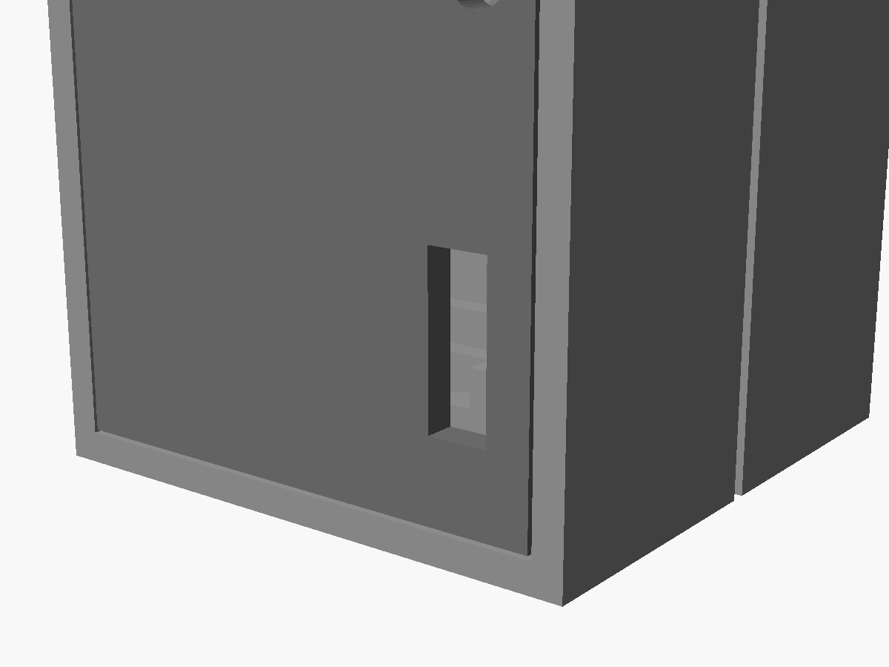 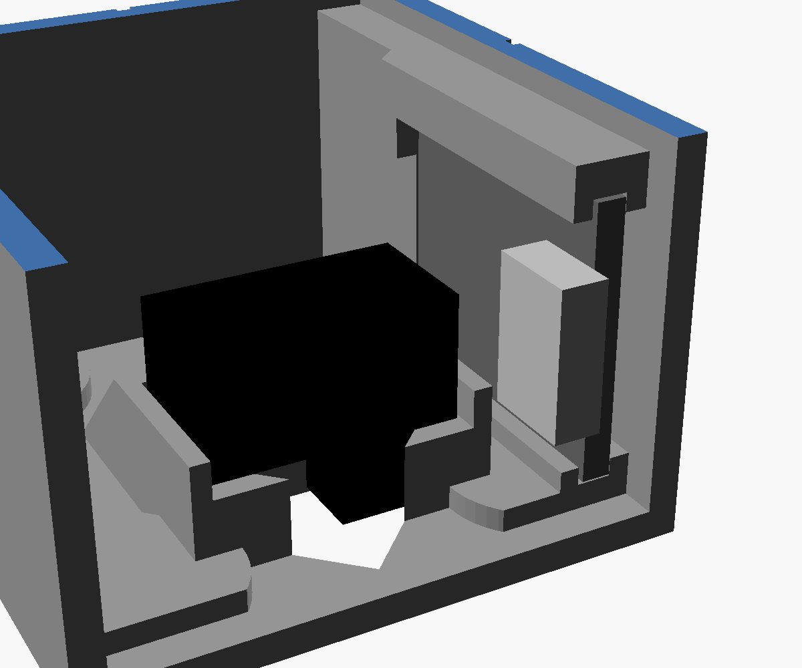

### Power-path board

- Built on a **26.6 × 20 mm perfboard** (10 × 8 holes, `pp_b` MEASURE, layout `../renders/spit_board_power.svg`) lying flat in the left leg just above the splint (z ≈ 171),
  parts up (`pp_parts` ≤ 6 mm), in side grooves, against the lid side: the wires run in front of it. It carries the
  **star ground**, R2 / R3, R15 / R16 and Q5 / R22. Q1 (SOT-23) is glued **upside down**, oriented as drawn (the drawing
  shows G / S / D seen from above, flipped), and wired with 3 short pieces of **insulated 30 AWG wire-wrap wire**
  (Kynar), so the crossing leads cannot short. Any logic-level P-MOSFET works (DMG2305UX, SI2301); **not** 10 V parts like IRF9520N / IRF9540.

### TPS63020

- Modelled (`buck`, `bk = [26.7, 17.7, 1.6]` measured, `bk_h`, `bk_lip`): flat in side grooves (lower ledges
  only, a lid tab holds its back edge), z = 124.7, ~10 mm in front of it for the wires.
  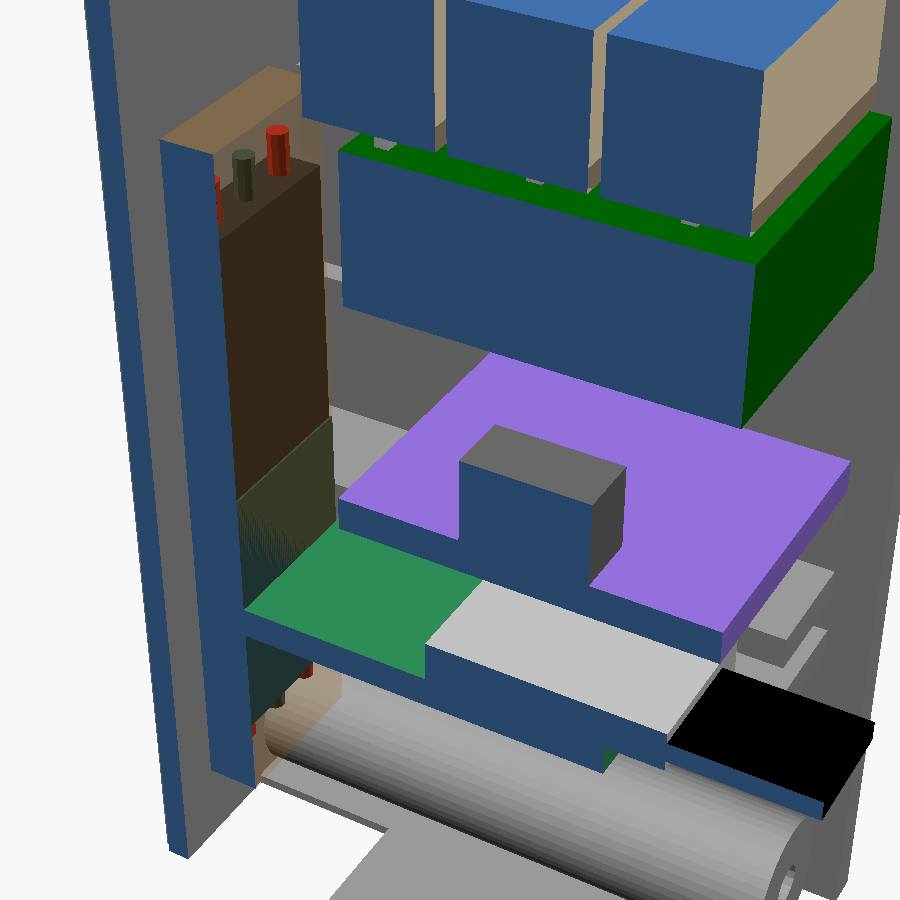

### Layout of the legs

- **Left leg, bottom to top**: micro-USB charge port (side wall, 3.1–17.4, receptacle at the heel) and switch in the foot; bottom shelf 22–24.5, cell
  29.7–94.7, top shelf 96.5, F1; microSD 116.5, TPS63020 124.7, TP4056 135.9 (flat, components up, C9 / D3 on its IN
  end); the power block's connectors X10, X12–X14 parked above it (144–166, visible from the back), X16 above the power-path
  board (180–202); splint 148.7–168.7,
  power-path board 170.8; vents in the lid at 141–149 and 217–230. Lid screws at 25.7, 103, 186, 210.8.
- **Right leg**: the same cell bay and F2, DS3231 107–145 (under the splint), BME280 190–205.

### Sound

SPIT talks **through its lower black panel** (right middle column, `speaker_col = 2`):

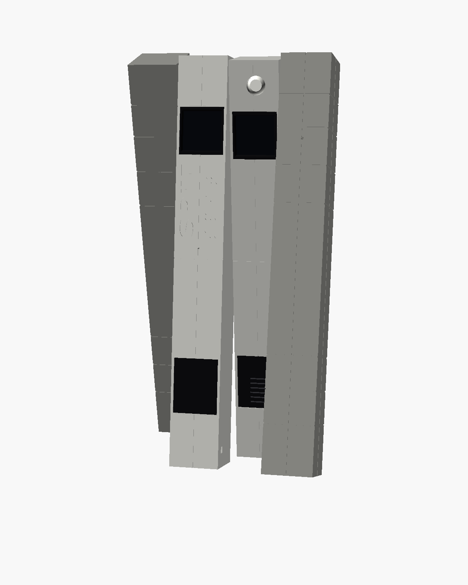

- **Speaker** 39 × 22 × 10 mm facing the front behind the lower panel (z 30–69): held at the front by two stops
  (bottom) and the splint's front plate (top), guided by side rails, pressed forward by two tabs on the right middle lid
  (`lid_mid`; the left one, `lid_mid_left`, has none: they would sit in the S3's wire loop). Insert it after gluing the
  halves (it crosses the seam).
- **Grille**: horizontal slots (1.2 mm every 3 mm) in that column's black plug → `mechanical/stl/spit_inserts_speaker.stl`.
- **Amplifier** MAX98357A (~19.4 × 18) in a slot on the inner front wall just above the splint (z 76.7–94.7). I2S0
  BCLK / LRC / DIN, VIN / GND on their own pair, C7 470 µF (Ø8 × 12) soldered on VIN / GND and lying across behind the
  board, between X6 and X5 (`c7`). GAIN default (9 dB); SD on AMP_SD (see *Signals*).
- **Microphone** INMP441 (10 × 10, castellated) in the left middle column between the upper screw posts, just under
  P1, far from the speaker: top-port MEMS, **chip side against the wall**, the sound hole facing a Ø1 hole in the
  vertical decor groove (invisible). Seal with a ring of foam tape, never glue on it. Own I2S1 (GPIO 14, 38, 15, local
  wires), L/R to GND.

### Motion sensor: AM312

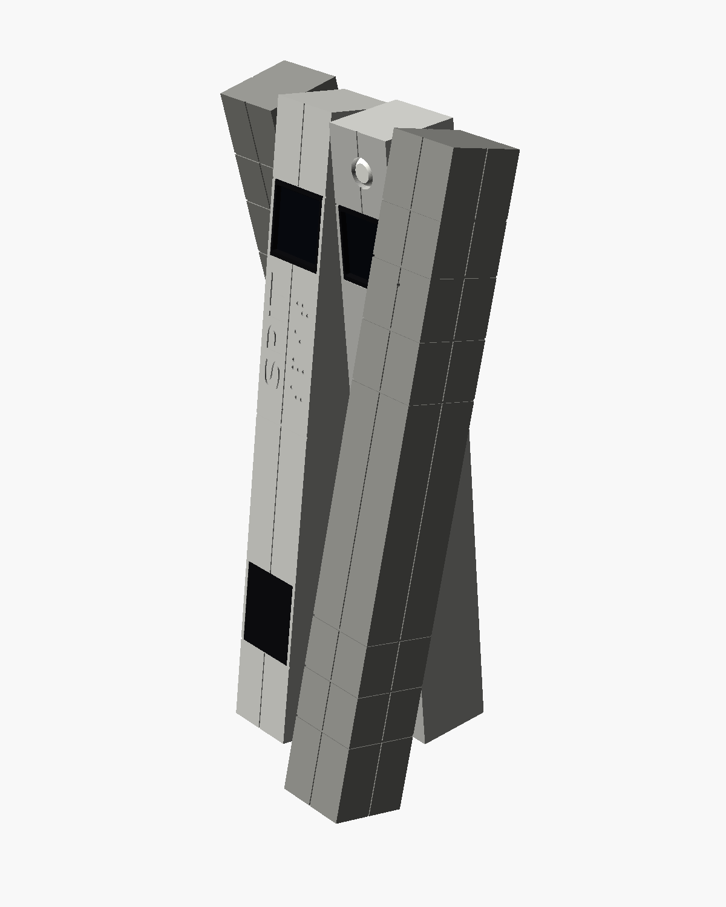

- **AM312** mini PIR (2.7–12 V, ~15 µA, push-pull output held ~2 s, active high) at the **top of the right middle
  column**, z ≈ 233, in the 14 mm band between the screen frame and the top lid screw (`pir_z = undef`; a value puts
  it between the middle screw rows instead).
- **Off the column axis**: at that height the middle tube ends on the left (collar + tube end, x ≤ 9.1) and the right
  tube's glued boss starts on the right (x 23.8); the sensor is centred between the two, `pir_x` = 16.45, **1.25 mm
  right of the axis**, 2.1 mm clear on each side.
- The bare detector (Ø8.15 TO-5 can) is soldered on the edge of a 10.25 × 8.10 breakout standing perpendicular to the
  front wall, flush with one end of that edge (`pir_pcb_a` = 90: the board runs up from the can, 6.2 mm above its
  axis; `pir_pcb_dn` its offset from the axis, estimated). The Fresnel cap goes in **from the inside**, dome
  first, until the dome meets the edge of the **Ø11.5 wall hole** (`pir_hole`, over the vertical decor groove): its
  top sits **flush with the front face**. A Ø14.8 ring on the inner wall (to 6.7 mm behind the face) centres the
  Ø12 rim; glue it there. The can slides into the skirt from the inside, the breakout spans 9.8–17.9 mm behind the
  face (`pir_cap_*`, `pir_dome_*`, `pir_can_*`, `pir_pcb`). Chosen on the trial plate `pir_test` (2026-10-24, tested
  with a Pro Micro): the holes print ~0.6 mm small (Ø10.8 / 10.5 / 11 / 11.5 drawn → 10.3 / 10.0 / 10.5 / 10.8),
  the dome never sticks out, and the largest hole (flush dome) detects well; the outside-cap hole came out too
  small for the Ø10.5 skirt. Breakout pins trimmed flush and the breakout sleeved in heat-shrink: the middle tube's wires exit 5 mm from it and turn down along the left wall right after the tube end.
- OUT → **R17 1 k on P2** → PIR wire through the middle tube → **GPIO3**; wakes the S3 with the ADXL345 INT1 and
  USB_DET. 3V3 / GND from P2 through an RC filter (**R21 100 Ω + C12 10 µF tantalum 16 V**, fc 160 Hz, ~40 dB at 20 kHz: the backlight PWM chops screen 2's
  current on the shared 3V3 wire), P2 decoupled by **C10 10 µF + C11 100 nF**.
- Uses: wake up when someone comes near, lock the PC (BLE keyboard) when they leave.

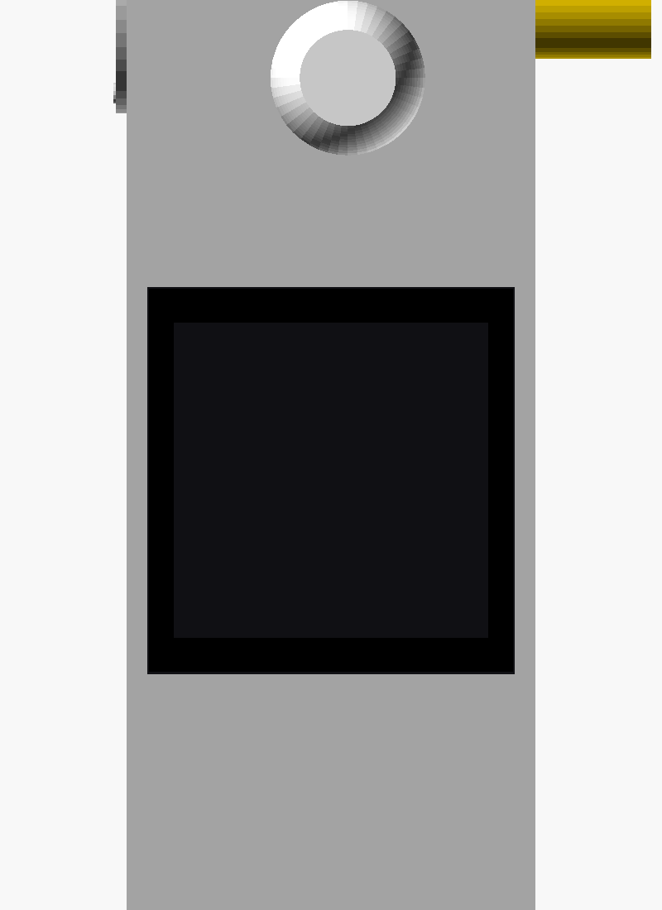 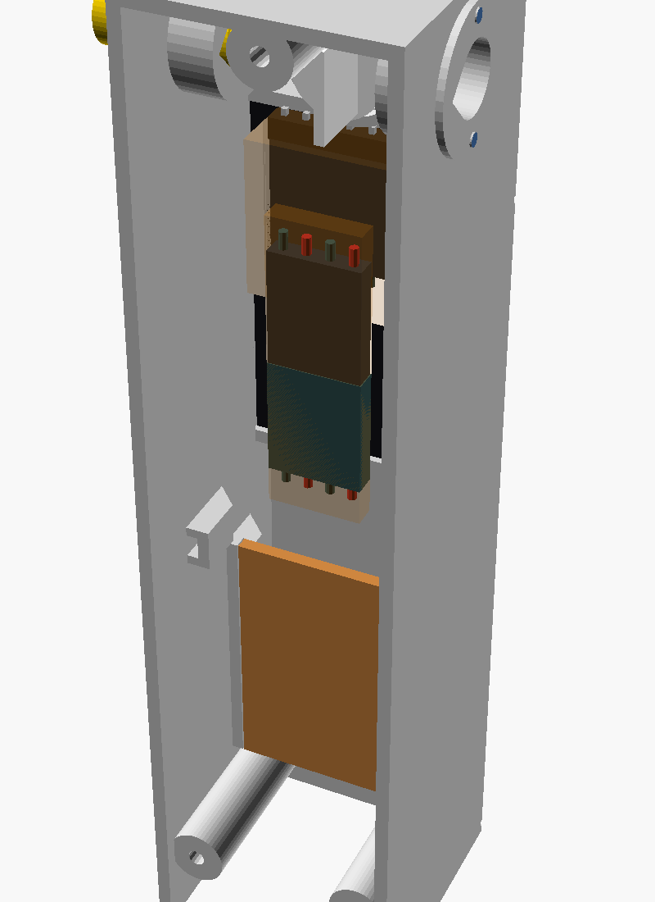

### Accelerometer, weather, clock

- **ADXL345** (GY-291) on the inner front wall of the left middle column just above the 99 mm screw row, stood off the
  wall by 1.2 mm (`pcb_gap`: cut pins and pads on that side). I2C mode: **CS → 3V3**, **SDO → GND** (0x53), bridged
  on the board; INT1 → GPIO2 for tap / motion wake-up.
- **BME280** (purple GY-BME280, 3.3 V, no regulator: check) in the **right leg** above its third screw row
  (z ≈ 190–205), the coolest place (far from the S3, the TPS63020 and the charger): board in a slot on the inner front
  wall, sensor side against the wall, facing a Ø1.5 vent (`bme_b`, `bme_port_dz` MEASURE). Read it right after waking
  up and calibrate an offset. Uses: weather trend from the pressure, comments on the room's humidity.
- **DS3231** RTC (ZS-042, CR2032) in the **right leg** above the top cell shelf (z ≈ 107–145), CR2032 holder against
  the wall, its 6-pin right-angle header kept and pointing **up** through a notch in the slot's top stop (X8). With a
  non-rechargeable CR2032, remove its charging resistor ("201", next to the 6-pin header, or the diode beside it). SQW
  not wired.
- I2C chained S3 → ADXL345 → middle tube → P2 → right tube → BME280 → DS3231; 3V3 / GND chained P1 → microphone →
  ADXL345 and P2 → right leg. The boards' pull-ups in parallel (~1.6–2.4 k): **100 kHz** with the glitch filter on;
  twist SDA with GND and SCL with 3V3 in the right tube (~1 m of bus next to SCK / BCLK).

### microSD

- 3.3 V-only breakout (no regulator, ≤ 25 × 25 with the socket at an edge) in the **left leg** above the top cell shelf
  (z 116.5, below the TPS63020), lying flat in side grooves with the socket mouth facing the lid; card inserted through
  a **12.5 × 2.2 slot in the left leg lid** (`lid_leg_sd`, push-push). The latched card
  sticks out of the lid face (5 mm, see below): pulled by hand.
- SDMMC 1-bit (CLK, CMD, D0; 10 k pull-ups R5–R9 on CMD, D0–D3 to its switched 3V3 if the reader has none), 3V3 from
  the TPS63020 next to it, **switched by Q5** AO3401A on the power-path board (SD_EN on GPIO36, low = on, R22 100 k gate
  pull-up keeps it off while the pin floats), a **dedicated GND** from P1 twisted with CLK through the left tube; R11
  33 Ω on CLK at the S3, C4 10 µF + C5 100 nF at the reader (hot insertion), **10 MHz**. Files can also be copied as
  USB mass storage through the S3's USB-C.
- Board measured 18.2 × 18.2 × 1.5 (`sd`), centred socket 14 × 11.5 × 2 overhanging the back edge by 2.8 (21 overall);
  latched card 6.9 beyond the socket mouth; the board sits **2 mm forward** (`sd_fwd` = 2): the card ends **3 mm proud of
  the lid**, 4.5 mm left in front of the board; still `MEASURE`: `sd_lip`. The 48 × 31 module in stock does not fit.
  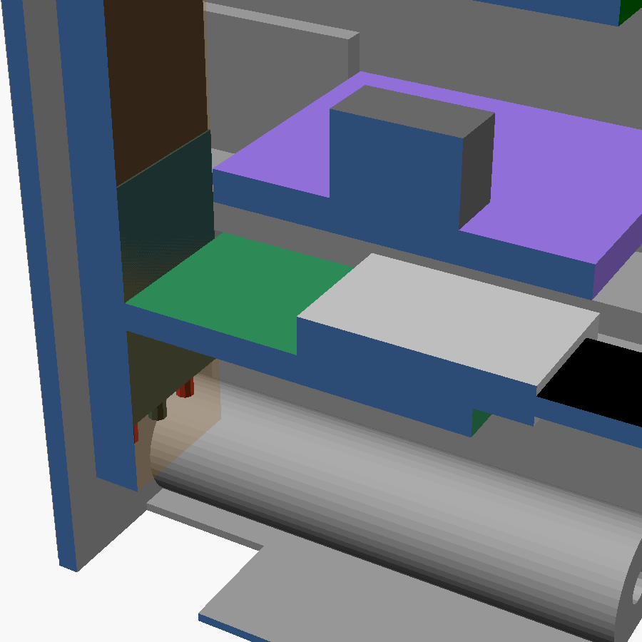

### Spare slot

`bb`, 13.4 × 18 on the inner front wall of the left middle column just above the splint (z 76.7–94.7), the same slot
as the amplifier on the other side: free.

### Switch

- **Switch** SW1: mini slide switch (body 12.95 × 6.9, lever 3.88 × 3.88 counted as 4 × 4, 6 mm travel) in the
  **left leg** floor, upside down on a 4 mm pad (45° slope) inside a 2 mm frame. The lever tip sits **0.5 mm above the
  underside of the floor**: nothing sticks out, it is flipped with a pen tip through the 10.6 × 4.6 slot. Wired after
  the power-path merge, before VSYS; charging works with it off.

## Wiring

### Wiring sketch

**Wiring sketch**: back view, SPIT lying face down, lids off, to scale (the left leg is on the right of the drawing).
Interactive version with dark mode: `hardware/spit_wiring.html`; regenerate the image with `node tools/wiring_svg.js`.

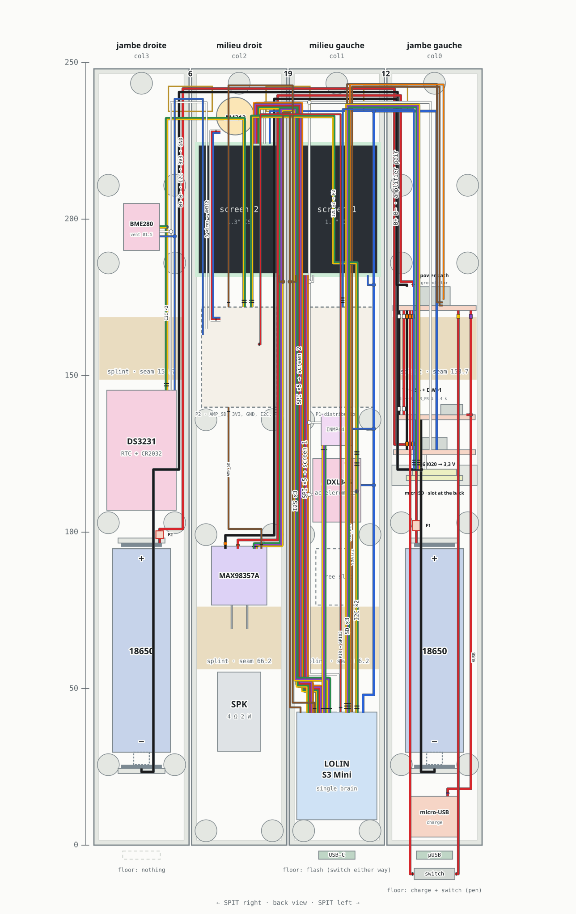

The wires are drawn in the **real colours of the wire kits** (see *Colour code*): thick = 26 AWG power, thin = 30 AWG;
a bus is drawn as its wires side by side, and the bars across a wire near its ends are the heat-shrink rings.

| Wires | Net |
|---|---|
| red / black, 26 AWG | pack B+ / B− (2 × 18650 in parallel, right cell → charger through all 3 tubes) |
| red / black, 26 AWG, **white band** | OUT+ / OUT−: TP4056 → power-path board (Q1, star) |
| red, 26 AWG, **yellow band** | VPATH: power-path board → floor switch |
| red / black, 26 AWG, **orange band** | VSYS / power GND: switch → star → TPS63020; own twisted pair → amplifier VIN |
| red / black, 26 AWG, **purple band** | VUSB / GND: charge port → TP4056 IN+ / IN− and the power-path board |
| white / blue, 26 AWG | 3V3 / logic GND: TPS63020 → left tube → P1 → S3 Mini 3V3 pin |
| white / blue, 30 AWG | 3V3 / GND of the screens (screen 2 through the middle tube) and sensors; microSD 3V3 local |
| grey, 26 AWG | speaker (+ marked with a pen at both ends) |
| yellow green red purple orange | SPI ×5 (SCK, MOSI, DC, CS, RST) to screen 1 (local) and screen 2 (through the middle tube) |
| yellow purple green, 1 ring | I2S0 to the MAX98357A, I2S1 from the INMP441 |
| yellow green, 2 rings | I2C (SCL, SDA) chain to the right leg |
| yellow purple green, 3 rings | microSD CLK, CMD, D0 (+ blue GND, 3 rings) |
| brown · red · orange | BL_EN, AMP_SD (1 ring) · PIR (1 ring) · USB_DET |
| grey, 30 AWG | analog sense: VBAT/2, VSENSE_B |
| grey | amplifier → speaker |

The sketch is to scale for the parts; the bus splits are drawn schematically (they physically happen on P1 / P2, see
`../renders/spit_board_p1.svg` and `../renders/spit_board_p2.svg`).

### Wires per tube

From the left leg (front view), silicone wire, **30 AWG (Ø0.8) for every signal and for the screens' / sensors'
3V3 / GND** (≤ 80 mA, < 20 mV drop), **26 AWG (Ø1.5) for the power wires** (B+, B−, amp VSYS/GND, 3V3 and GND to P1):

| Tube | Wires | Fill of the Ø7 bore |
|---|---|---|
| left (col0 ↔ col1) | **14**: B+/B−, VBAT/2, USB_DET, SD_EN, VSENSE_B, logic GND and 3V3 to P1, amp VSYS/GND, microSD CLK, CMD, D0, GND | ~38 % |
| middle (col1 ↔ col2) | **19**: B+/B−, amp VSYS/GND, screen 2 (SCK, MOSI, DC, RST, CS2, 3V3, GND), BL_EN, AMP_SD, I2S ×3, PIR, SDA, SCL | ~38 % |
| right (col2 ↔ col3) | **6**: B+/B− of the right cell, SDA, SCL, 3V3, GND | ~14 % |

With 28 AWG signals the middle tube would be ~60 % full (very hard to pull and to keep turning).

- The middle tube carries two GNDs on purpose: the amp's (twisted with its VSYS, straight back to the star) and
  screen 2's logic GND (from P1), so the amp's current pulses never flow in the logic ground.
- **Twisted pairs**: B+/B−, the amp's VSYS/GND, microSD CLK/GND. 26 AWG drops < 0.1 V on the power runs.
- Deburr the tube ends, strain relief (heat-shrink / hot glue) at the solder joints, a short heat-shrink sleeve on the
  bundle where it leaves each tube. Thread bare wires, crimp / solder after.
- **Tie anchors** (`ties`, `TIES`): 15 printed bridges on the side walls for a 2.5 mm cable tie (left leg 112 / 179 /
  218, left middle 50 / 80 / 128 on both walls, right middle 106 / 178 on both walls, right leg 111 / 179), clear of
  the screw posts and splints and ≥ 20 mm below the tube axis. In the screen band the two lid ribs channel the bundle.

### Colour code

**Power goes in pairs** (since 2026-10-27): **red / black** for the battery and 5 V side (B+/B−, VUSB, VPATH, VSYS
and their GND), **white / blue** for the regulated 3V3 and its logic GND, in 26 AWG and in 30 AWG alike. **Blue is
power only** (regulated GND), never a signal; never yellow for 3V3. Signals: one colour per *role* (30 AWG, 10-colour
kit, black unused in 30 AWG), the same on every segment of a signal; heat-shrink rings at both ends tell the
buses apart: no ring = screens / sense lines, **1 ring = I2S (amp and mic) and PIR**, **2 rings = I2C**, **3 rings =
microSD**. **Power rails sharing the red / black pair get one coloured band** instead (10 mm of coloured heat-shrink,
shrunk 2–3 cm from each end, the same on the + wire and on its GND; slide it on before soldering / crimping): none =
B+ / B− of the cells, **white** = OUT+ / OUT− of the TP4056 (protected side: never swap it with B−), **yellow** =
VPATH, **orange** = VSYS (star, TPS63020 input, amp pair), **purple** = VUSB. The white / blue 3V3 pairs need no band.
Every combination is unique inside each tube: the two red / black 26 AWG pairs of the left and middle tubes are the
right cell's B+ / B− (no band) and the amp's VSYS / GND (orange band). Label both ends anyway (28 wires meet at the
S3's carrier). Coloured mini cable ties can replace the ring count at the ends, but **no tie within 25–30 mm of a tube end**
and only loose ones on the 30 AWG.

| Colour | Signals (rings) | Length (30 AWG, cut lengths from [spit_harness.pdf](spit_harness.pdf)) |
|---|---|---|
| white | 3V3 of the screens and sensors (VCC is white, as in industry) | 2.2 m |
| blue | GND of the screens and sensors (pair of the white 3V3) · SD GND (3) | 2.2 m |
| yellow (clocks) | SCK · BCLK, MIC_BCLK (1) · SCL (2) · SD_CLK (3) | 3.6 m |
| green (data) | MOSI · DIN, MIC_SD (1) · SDA (2) · SD_D0 (3) | 3.5 m |
| purple (select / frame) | CS1, CS2 · LRC, MIC_WS (1) · SD_CMD (3) | 2.5 m |
| red (status) | DC, INT1 · PIR, PIR OUT (1) | 2.0 m |
| orange | RST, USB_DET | 1.5 m |
| brown (enables) | BL_EN · AMP_SD (1) · SD_EN (3) | 2.2 m |
| grey (analog sense) | VBAT/2, VSENSE_B | 1.5 m |

Middle tube: SCK yellow, MOSI green, CS2 purple, DC red, RST orange, BL_EN brown, BCLK / LRC / DIN yellow / purple /
green with 1 ring, AMP_SD brown 1 ring, PIR red 1 ring, SDA / SCL green / yellow 2 rings, 3V3 / GND white / blue. Left
tube: VBAT/2 grey, USB_DET orange, VSENSE_B grey, SD_EN brown 3 rings, SD_CLK / CMD / D0 yellow / purple / green 3 rings, SD GND blue
3 rings. Power (26 AWG): red B+ / black B− (cells, no band), red / black with a white band (OUT+ / OUT−), yellow
(VPATH), orange (VSYS: star, TPS63020 input, amp pair) or purple band (VUSB), white 3V3 / blue logic GND (TPS63020 → P1
→ S3), grey speaker.

### Distribution boards P1 / P2

Two stripboards 24 × 32 (9 × 12 holes, strips across) standing below the screens (z 139.9) in the middle columns,
where the buses split (layouts: `../renders/spit_board_p1.svg`, `../renders/spit_board_p2.svg`):
- **P1** (left middle): GND (two strips), 3V3, BL_EN (R4 10 k to GND), DC, RST, MOSI; C2 10 µF + C3 100 nF.
- **P2** (right middle): AMP_SD_S3 | AMP_SD (R10 1 k across a strip cut, R18 10 k), GND, 3V3, SDA, SCL, PIR_VDD
  (R21 + C12), GND, PIR | PIR_OUT (R17 1 k across a strip cut); C10 / C11. The S3's wire lands before the resistor
  (A11, A4), the module's after it (F11, F4).

### Hand-wired boards

Names: **P1–P4** are the hand-wired boards, **X1–X16** the connectors only, the modules keep their own names.

**Where to start**: [spit_harness.html](spit_harness.html) and its printable copy [spit_harness.pdf](spit_harness.pdf) (A4: each step's instructions on one page, its
diagram on its own page(s), in portrait or landscape, split by tube when the text would print under 7 pt; `python3 -I tools/harness.py`, the PDF through headless Firefox with `tools/html2pdf.py`) list all 112 wires in 7 bench-tested
steps (power block, charge port / switch / cells, S3 carrier, P1 and the left middle, left tube, middle tube and the
right middle, right tube and the right leg), each wire with both ends: grey dot = soldered, blue D = Dupont, orange
XH = JST-XH, F / M = female / male contact; block frames: green = board P, purple = module, blue = Dupont side,
orange = JST-XH side. The board drawings below use the same end code.

Four boards carry the harness; each has a hole-by-hole build drawing generated by `python3 -I tools/boards.py`, which
first checks the description: every net connected, no two nets touching, no lead under another part, on the pad
boards no power net (VUSB, VPATH, VSYS, OUT+, B+) next to any other net (GND, GPIO, 3V3 or another power net), and
every part on the same nets, under the same names, as in the KiCad schematic (`tools/kicad_sch_gen.py`).
All boards are **single-sided** (copper on one face only): parts on the bare face, every joint on the copper face. Each drawing shows the component side and
the solder side (mirrored), the strip cuts, solder bridges, bare buses and insulated jumpers, every harness wire
numbered in its kit colour with its heat-shrink rings, the **connectors** its wires are crimped into (harness side,
pin 1 on the left, every contact in order: this board's wire number in its colour, plugged keying cavities in grey,
the other contacts with their signal) and the tables of parts, links and wires (hole → destination → connector pin).
`boards.py` also checks that each wire's signal is the signal of the contact it is crimped into (`CONNS`).

| Board | Size, holes | Drawing |
|---|---|---|
| **P3** S3 carrier (left middle, z 8–43) | 25.6 × 34.4 pad board, 10 × 13 | `../renders/spit_board_s3.svg` |
| **P1** (left middle, below screen 1) | 24 × 32 stripboard, 9 × 12 | `../renders/spit_board_p1.svg` |
| **P2** (right middle, below screen 2) | 24 × 32 stripboard, 9 × 12 | `../renders/spit_board_p2.svg` |
| **P4** power-path board (left leg, z 170.8) | 26.6 × 20 pad board, 10 × 8 | `../renders/spit_board_power.svg` |

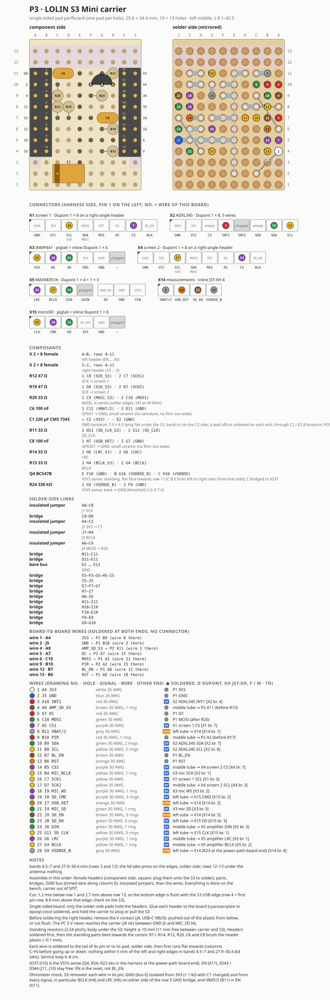
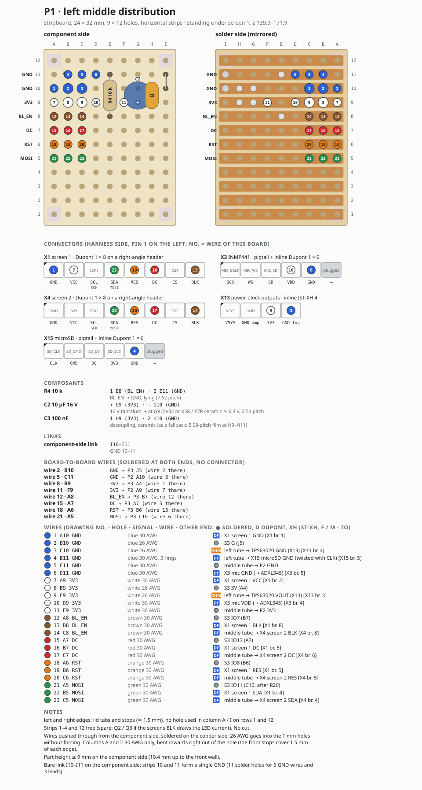 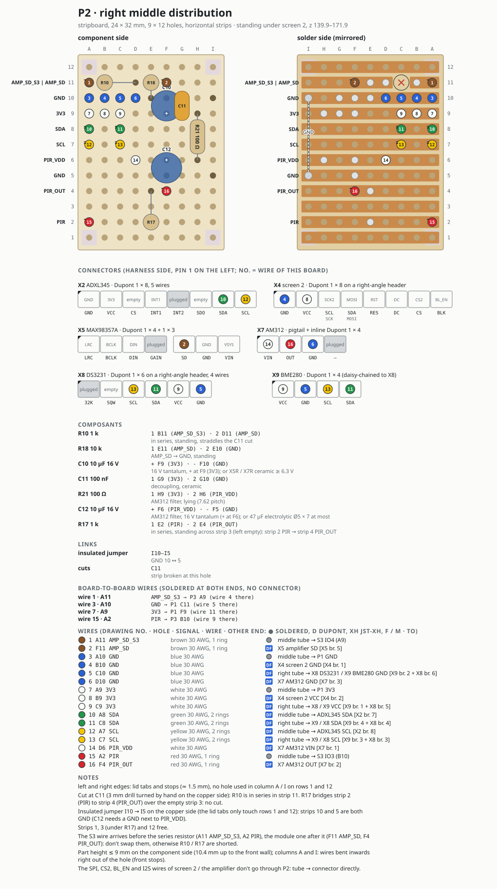
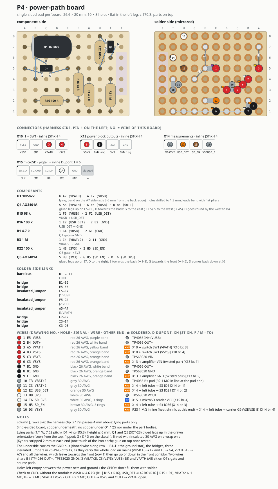

- **S3 carrier**: the 2 × 8 female headers and every part (R11–R14, R19, R20, C6, C8 standing, C1 lying flat) on the component side
  under the S3; on the solder side only the GND bus (column E), the bridges, four insulated jumpers and the 28 wires,
  each soldered on its pin's tail or pad and leaving inwards. Cut 1.2 mm below row 1 and 2.7 mm above row 13 (row 4,
  the first pin row, 8.8 mm above the S3's USB edge). The headers are glued to the board (only single-sided pads hold
  them); the V (VBUS) contact is pulled out. Rows 3 and 12 stay clear at the edges (lid tabs), rows 12–13 under the
  antenna stay empty.
- **P1 / P2**: wires go in from the component side and are soldered on the copper side (towards the lid); P2 has one
  strip cut (C11) for the series resistor R10, R17 standing from strip 2 to strip 4, and an insulated jumper I10 → I5 on the copper side. Only
  30 AWG in columns A / I, bent inwards (the front stops cover 1.5 mm of each edge); parts ≤ 9 mm tall.
- **Power-path board**: parts on top (all lying, D1 1N5822 axis 3.6 mm from the back edge, Q1 / Q5 glued upside down
  with insulated 30 AWG wire-wrap leads), the GND star bus along the front row and every wire on the underside,
  leaving towards the front channel; three insulated jumpers in 26 AWG offcuts (VUSB F5 → F7 / G4, VPATH A5 → A7: the whole load on mains). OUT+ has its own
  pad (B4) with no neighbour; R2 (B+) is soldered in line in the harness at the B+ pad end.
  Column J rows 3–6 stay flat: the tie anchor at z 179 is 4 mm above.

### Connectors (demountable wiring)

Everything is tested **on the bench first**, then fitted, and any module can come out again **without
re-soldering**. The harness is soldered once (P1, P2, the S3's carrier, the power-path board, the cell plates and the
bundles through the tubes, which cannot be threaded with connectors on them anyway); **every module plugs into it**.
One family for nearly everything: **2.54 mm Dupont crimp housings**, pushed straight onto the modules' own header pins,
so on the bench the same modules take ordinary breadboard jumpers. Where a header has no room (the microphone, the
AM312, the microSD), a 5–6 cm pigtail soldered on the module ends in an inline Dupont pair. The 26 AWG power wires get
locking **JST-XH** (3 A) inline pairs, crimped like the Dupont ones (X10, X12–X14, X16).

Modelled in `mechanical/scad/spit.scad` (`plugs`, the `CONN` list): each connector is a box (mated housings + 4 mm to bend the wires)
checked against the walls, screw posts, splints, shelves, boards, lid tabs, tie anchors, pivot bosses, C7, a bundle
corridor in the middle columns (tube end → P1 / P2) and the other connectors: the model echoes a WARNING on any clash
(none now).

The two legs from the back, lid off (`tools/build4.sh renders`): left leg, its power block connectors in a cut just
above them (seen from behind, so SPIT's left is on the right: X12 / X13 against the lid, X10 in front of them, X14
alone in a third row, the front channel free), the XH pairs from behind (male housing below, from `connectors.scad`'s `XH()`, XHP female
plugged in from above, inside their translucent check box), right leg and its DS3231 / BME280 area. Every connector
is drawn in detail inside its check box (`xh_pair()`, and `dupont()` for X1–X9 / X15: header base + female housing,
or the two housings of an inline pair, with coloured wire stubs). The mated pair
drawn is ~17 mm long (`xh_male_back`, `xh_female`) inside the 22 mm checked box (`xh_inline`): measure a real pair.

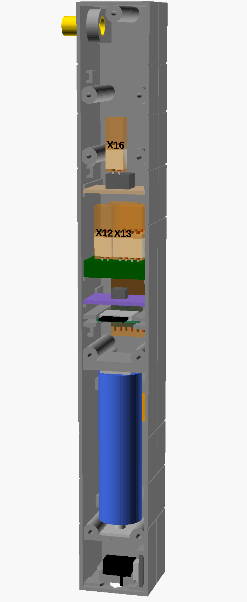 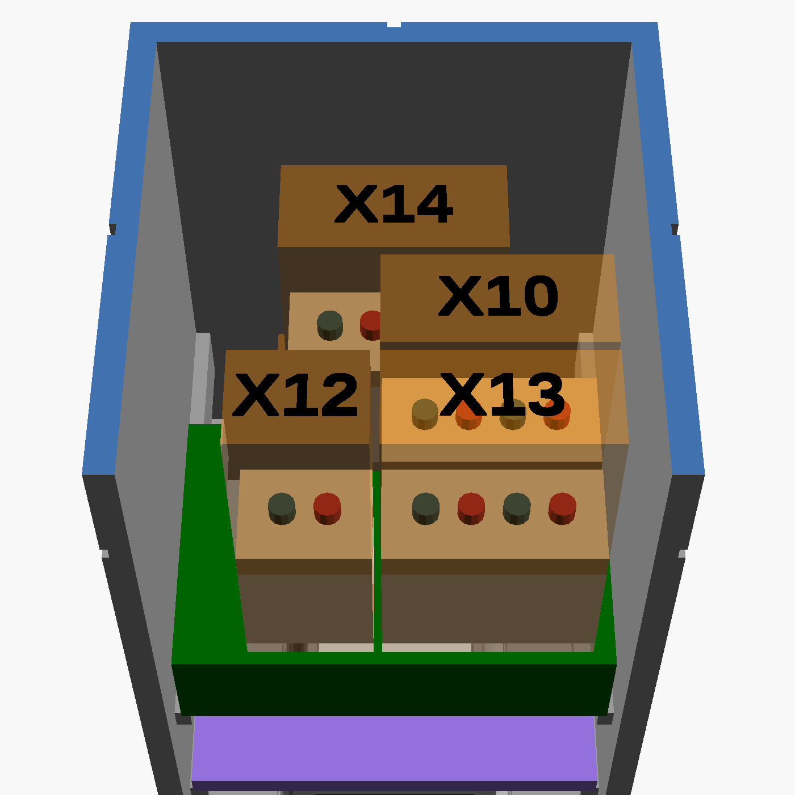
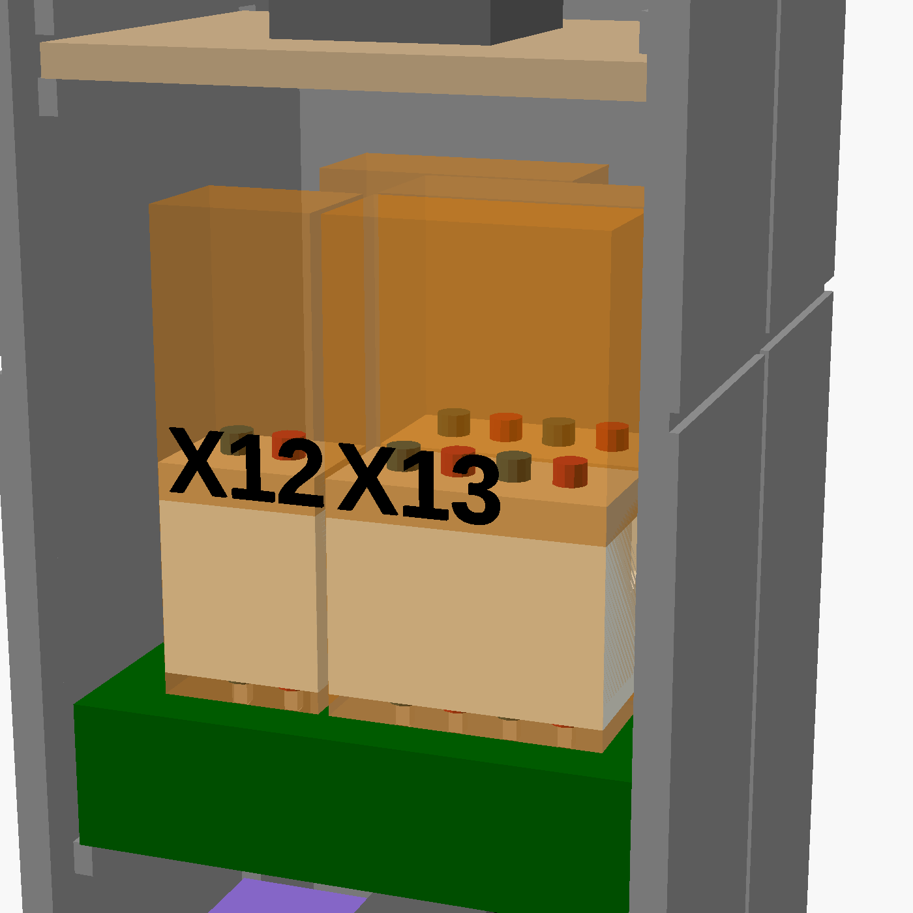
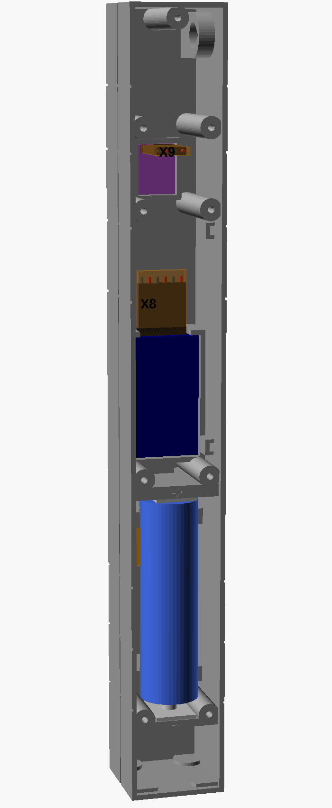 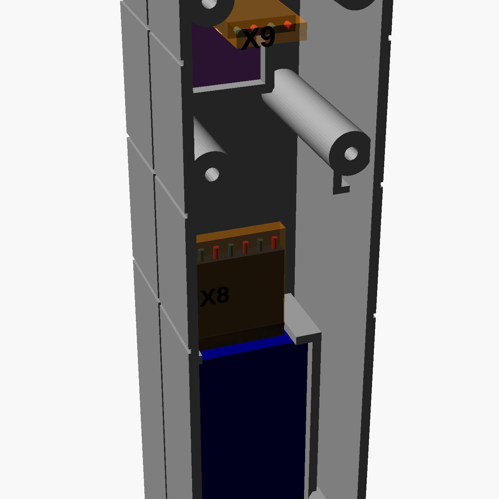

| Ref | Module ↔ harness | Type · keying (pin order from pin 1) | Where (z, mm) |
|---|---|---|---|
| (socket) | **LOLIN S3 Mini** ↔ its carrier | 2 × (2 × 8) female headers, 8.5 high | left middle, 8–43: open the lid, slide S3 + carrier out on their wire loop, pull the S3 off |
| X1 | screen 1 | Dupont 1 × 8 (GND VCC SCL SDA RES DC CS BLK) on a **right-angle header** on the screen's back, pins down; the housing lies flat on the back · **1 mm rib glued on its lid-side face**: reversed, the rib hits the screen board | left middle, 205–223 |
| X2 | ADXL345 | Dupont 1 × 8 (GND VCC CS INT1 INT2 SDO SDA SCL; 5 wires) · **INT2 pin pulled**, its cavity plugged · SDA / SCL contacts carry **two wires** (S3 carrier + on to P2); VCC / GND come from X3's harness side | left middle, along its left edge, 103–124 |
| X3 | INMP441 | pigtail + inline Dupont 1 × 6 (SCK WS SD VDD GND + 1 empty; L/R bridged to GND on the board) · empty position plugged on the female side · VDD / GND female contacts carry **two wires** (from P1 + on to X2), so unplugging the mic keeps the ADXL345 powered | left middle, parked against the lid, 103–131 |
| X4 | screen 2 | as X1 | right middle, 205–223 |
| X5 | MAX98357A | **two housings**: 1 × 4 (LRC BCLK DIN GAIN) with the **GAIN pin pulled**, cavity plugged, + 1 × 3 (SD GND VIN) · the 3-way reversed only swaps SD and VIN through R10 1 k (harmless); mark the 4-way's side | right middle, top edge of the amp, ~93 |
| X6 | speaker | Dupont 1 × 2 on a 2-pin header in place of the screw terminal · no key (reversed = polarity swap, harmless) | right middle, bottom edge of the amp, ~78 |
| X7 | AM312 | pigtail + inline Dupont 1 × 4 (VIN OUT GND + 1 empty) · empty position plugged | right middle, parked against the lid beside the screen, 191–225 |
| X8 | DS3231 (ZS-042) | Dupont 1 × 6 on its right-angle header (32K SQW SCL SDA VCC GND; 4 wires) · **32K pin pulled**, cavity plugged | right leg, above the board, 145–166 |
| X9 | BME280 | Dupont 1 × 4 (VCC GND SCL SDA) · no key: reversed, the I2C bus just hangs (no supply short) · all 4 contacts carry **two wires** (from P2 + on to X8) | right leg, top edge, ~204 |
| X10 | J1 charge port + SW1 ↔ power block | **JST-XH 4** inline (VUSB, GND, VPATH, VSYS), polarised: the two floor cables (charge port, switch) end in one housing (X11 no longer exists) | left leg, parked above the TP4056, front row, 144–166 |
| X12 | left cell ↔ power block | JST-XH 2 inline (B+, B−), female on the cell side | left leg, parked, 144–166 |
| X16 | right cell ↔ power block | JST-XH 2 inline (B+, B−), female on the cell side: the pair comes down from the tubes; the two cells join on the TP4056's B+ / B− pads (two wires soldered on each) | left leg, above the power-path board between the lid screw posts, 180–202 |
| X13 | power block ↔ tubes | JST-XH 4 inline (amp VSYS / GND, 3V3, logic GND) | left leg, parked, 144–166 |
| X14 | power block ↔ tubes | **JST-XH 4** inline (VBAT/2, USB_DET, SD_EN, VSENSE_B), polarised | left leg, parked, its own row in front of X10, 144–166 |
| X15 | microSD reader | pigtail + inline Dupont 1 × 6 (CLK CMD D0 3V3 GND + 1 empty) · empty position plugged | left leg, front channel, 107–141 |

- **Keying** (2.54 Dupont housings are not polarised): pull an unused header pin off the module and plug the matching
  housing cavity with a cut-off male pin glued in; inline pairs get one extra position, plugged on the **female side,
  which is always the powered harness side** (no live pin exposed). Plug and unplug only with SW1 off, the charger and
  the S3's USB-C out.
- **Power block**: the TP4056, the power-path board and the TPS63020 are soldered together once (4–5 cm loops) and
  bench-tested as one unit; X10, X12–X14 and X16 are its only joints with the rest, parked in the free cavity above the TP4056
  (z 144–166, y 18–29). The boards go into their flat slots **one by one** from the back, bottom-up, on their loops;
  the through-wires (microSD, right cell) run in the front channel.
- **S3 carrier**: **single-sided perfboard with separate pads** (not stripboard: the S3's pins sit in two double rows), cut to
  25.6 × 34.4 (1.2 mm below the first row), pad-free bands at 4.5–7 and 27.9–30.4 for the ribs / lid tabs. Wires on its back in the 6 mm gap with a
  **6–8 cm service loop**; C1, R11–R14, R19, R20, C6 and C8 stand on its component side under the S3
  (`../renders/spit_board_s3.svg`).
- **Two wires in one contact** (X2 SDA / SCL, X3 VDD / GND, X9 VCC / GND / SCL / SDA: 8 contacts): crimp both 30 AWG
  together without folding.
- **Crimping 30 AWG in Dupont contacts** (made for 22–28 AWG): strip 3 mm, fold the strands back once to double them,
  crimp the conductor wings on that; slide 5 mm of 1.5 mm heat-shrink on first and crimp the insulation wings over it.
  Tug-test every contact. Ratchet crimper SN-28B / PA-09. Mark each housing with its X number and a dot of paint on
  pin 1. Pull each harness end ≥ 5 cm out of the back to crimp it. A drop of hot glue on each housing once the bench
  test passes; tape X3 / X7 to the lid side.
- **Service loops**: 3–5 cm of slack at every module so it comes out of the back on its wires before being unplugged;
  no loop within 25–30 mm of a tube end.
